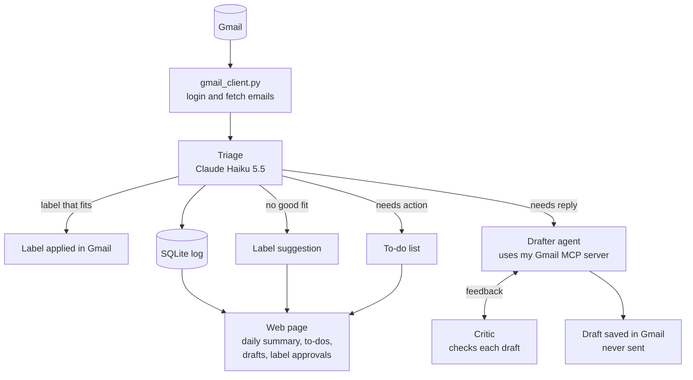

# Inbox Agent

An AI agent that organizes my Gmail. It sorts every email into labels, flags the emails that need a reply or an action from me, drafts replies, and shows everything on a web page with a daily summary. Several Claude models work together, each with its own job, and nothing is ever sent without my approval.

**Status:** Steps 1 to 4 done. The agent sorts each email into one of 15 labels designed by Claude Opus and reviewed by me, flags what needs a reply or an action, and suggests new labels for emails that fit none. It adds the labels in Gmail and archives sorted emails, so the inbox only holds what still needs me. It records every decision in a database, so it never sorts the same email twice and any run can be undone. **It sorted my whole backlog with the Message Batches API: 6,547 emails for $1.54, taking the inbox from 6,494 emails to 60.** Step 5 is built: my own Gmail MCP server, whose tools can search and read emails, list my to-dos and save reply drafts, but never send, delete or archive. It works in Claude Desktop. Step 6 is built: a Drafter agent (Claude Sonnet) that writes replies in my style, using a writing-style file learned from my sent emails and the MCP server's tools, and a Critic (Claude Opus) that checks every draft before it can be saved. **Now: Step 7, the web page:** a FastAPI app with HTML templates, HTMX and Tailwind, with Action needed, Unsorted and History pages, and a two-stage read so that actions come with exact steps, links and deadlines. The first pieces are built: the web app runs on my computer, where only I can open it, with a shared layout (a menu for its three pages and the "Sort new emails" button), styled with Tailwind and the Inter font. A home page gives an overview: what needs me, new emails not sorted yet, Unsorted emails, the last sorting run and what sorting has cost. The Action needed page lists my to-dos that are still in my inbox, one row per conversation with an "Open in Gmail" link, and Claude Desktop gets exactly the same list. When the Gmail login has expired, I sign in again from the page itself.

## How it works



Built so far: `gmail_client.py`, Triage (including applying labels in Gmail), the Label Designer, the SQLite log, the backlog sorter, the Gmail MCP server, the Drafter and the Critic. The web page is in progress.

### The Gmail MCP server's tools

| Tool | What it does | Can change Gmail? |
|---|---|---|
| `search_emails` | Searches all mail with Gmail's search syntax, and returns sender, subject, date, preview and labels | No |
| `read_thread` | Returns a whole conversation: each message's sender, recipients, date and text | No |
| `list_todos` | My to-do list: one entry per conversation the agent flagged as needing a reply or an action that's still in my inbox, the same list as the web page | No |
| `create_reply_draft` | Saves a reply inside a conversation as a draft. It is never sent. Reply by default, Reply all only when asked | Only adds a draft |

There is deliberately no tool to send, delete, archive or relabel anything.

### How the MCP server works

**Three layers.** `gmail_client.py` holds everything that talks to Gmail, and my own scripts use all of it, including the functions that change labels. `gmail_mcp_server.py` is the menu offered to AI apps: it picks the safe abilities, describes them for a model and leaves the rest out. The model itself (Claude) only reads and writes text. When it wants a tool, it asks the app it runs in, and the app makes the call. The model never talks to the server directly.

```
You ──▶ App (Claude Desktop) ──▶ Model (Claude): "call list_todos"
              │
              ▼
        gmail_mcp_server.py ──▶ Gmail + my database
              │
              ▼
        App ──▶ Model: "here's the result" ──▶ answer to me
```

**stdin, stdout and stderr.** The app starts the server in the background and connects to its three standard channels:

```
App                                   gmail_mcp_server.py
 │ ── stdin:  requests (JSON) ─────────▶ │
 │ ◀─ stdout: answers (JSON) ─────────── │
 │ ◀─ stderr: plain text for humans ──── │  → saved to a log, never read as JSON
```

stdin and stdout carry the conversation as JSON messages: the handshake, the list of tools, then each tool call and its answer. stderr is a side channel for warnings and errors, which the app stores in a log. That's why the code never prints to stdout: a stray message there would be read as JSON and break the connection.

| Part | Model | Job |
|---|---|---|
| Triage | Claude Haiku 5.5 | Sorts each email, flags needs reply / needs action. Cheap and fast, because it runs on every email |
| Label Designer | Claude Opus 5.5 | Reads a few hundred emails and my existing labels, and suggests labels with descriptions. Runs rarely, so the best model is worth the cost |
| Drafter | Claude Sonnet 5.5 (effort medium) | An agent: decides for itself whether to look up past emails with the MCP server's read-only tools, then writes a reply |
| Critic | Claude Opus 5.5 (effort high) | Checks each draft against everything the Drafter saw, for made-up facts, promises I never made, missed questions and wrong tone, and sends it back for changes |
| Action reader (planned) | Claude Haiku 5.5 | Reads the whole email when it may need action, and finds what to do, where and by when. Answers yes, no or unsure |
| Action reviewer (planned) | Claude Sonnet 5.5 | Looks only at the emails the Action reader was unsure about |

## Design decisions

### Who decides what

The agent acts on its own when an action is low-risk and easy to undo. It needs my approval when an action changes how the whole system behaves, and it never does anything that can't be undone.

| Action | Who decides | Why |
|---|---|---|
| Apply a label | Agent alone | Affects one email, easy to undo |
| Archive a sorted email | Agent alone | Easy to undo. Emails that need a reply or an action, and Unsorted ones, stay in the inbox |
| Flag "needs reply" or "needs action" | Agent alone | It's only information |
| Create a new label | Agent suggests, I approve | Changes how every future email is sorted |
| Draft a reply | Agent alone | It's only a draft |
| Send an email | Never the agent | Can't be undone |

**Why the agent doesn't create labels by itself:** it only sees one email at a time, but a good label covers a pattern across many emails. Letting it create labels freely would lead to near-duplicates ("Job Alerts", "Job Notifications"), each new label would change where future emails go, and anyone who emails me could influence my inbox's structure. Instead, emails that fit no label go to "Unsorted" with a suggested label. The web page groups similar suggestions, and I approve, edit or reject them.

### Safety

- **No send or delete tools.** The agent can label, flag and draft, nothing more. Even if an email tricks the model, it can't send or delete anything.
- **Prompt injection defense.** Anyone can email me, so email content is untrusted. The email goes inside `<email>` tags, and the prompt says to treat everything inside them as content, never as instructions. Triage also has no tools, so the worst a malicious email can do is get itself mislabeled.
- **Least privilege, and being honest about its limits.** The app asks Google only for the permissions the current step needs. Steps 2 and 3 were read-only. Applying labels needs `gmail.modify`, the narrowest Google permission that can change labels on emails. It also covers drafts and sending, so the real safety boundary is the code: `gmail_client.py` has no function that sends or deletes anything.
- **Every change can be undone.** The agent only adds labels and archives, and it never deletes anything. Every change is logged, and `undo.py` reverses the last run: it removes the labels the agent added and moves archived emails back into the inbox. Labels that were already on an email, for example from my own Gmail filters, are recorded as such and left alone by undo.
- **Archive only what doesn't need me.** Emails that need a reply or an action, and Unsorted ones, stay in the inbox. So a wrong label can never hide something I have to deal with.
- **Start small and check.** The first real run labeled only 10 emails. A separate check read the labels back from Gmail, rather than trusting the script's own output. Undo was tested the same way before relabeling.
- **Secrets stay out of Git.** The API key (`.env`), the Google app file (`credentials.json`) and my saved login (`token.json`) are all in `.gitignore`.
- **Less data sent to the model.** Triage sends only the sender, subject and preview, not the full email.
- **The MCP server is safe by construction.** Its tools can only read and save drafts. Each tool is marked with MCP annotations (`read_only_hint`, `destructive_hint`), so apps know which ones change something and can ask before using them. The server also tells every app that email content is untrusted, and to treat it as information, never as instructions.
- **Personal data stays out of Git.** The Label Designer's suggestions quote subjects from my real emails, and its label descriptions name companies I applied to, so `labels_proposed.json` is in `.gitignore`. The final label file will be handled the same way, with a shareable example file in the repo instead.
- **Only my computer can open the web page.** Its server listens on 127.0.0.1 rather than on the network, so other devices on the same Wi-Fi can't reach it. That matters because the page will have buttons that change my Gmail.
- **Email content can't run as code on the web page.** The templates escape every value they fill in, so a `<` in an email subject is shown as text. A test with a planted `<script>` tag confirmed it.
- **No outside scripts on the web page.** Every file the browser loads comes from my own app, because a script from somewhere else, running at my app's address, could read my pages and press my buttons. So Tailwind's styles get built into a local CSS file instead of loaded from a CDN, and FastAPI's automatic documentation pages, which load scripts from a CDN, are switched off. The font is served by the app too: loading it from Google Fonts would tell Google about every page I open.
- **The web app can't hand out other files.** It only serves files from `web/static/`. Requests that try to climb out of that folder, like `/static/../../token.json`, get "404 Not Found".

### Engineering choices

- **The right model for each job.** Haiku for high-volume sorting, stronger models only where judgment matters.
- **Structured outputs instead of parsing text.** Triage describes the answer it wants as a Pydantic class. The API forces Claude to answer in exactly that shape, and the label field only allows names from the label list, so Claude can't invent a label.
- **The agent reads, the code writes.** The Drafter only gets read-only tools (search and read emails). Saving the draft is done by my code, and only after the Critic approves. The model can't skip the review, because it has no way to save anything itself.
- **Limits are enforced in code, not only asked for in the prompt.** The Drafter's prompt says its lookups only cover emails with the people who wrote in the conversation, but the code also adds that limit to every search and refuses other conversations. A prompt can be ignored or tricked; code can't.
- **Learn the style once, reuse it every time.** Instead of the Drafter looking up how I write for every draft, a writing-style file is built once from my sent emails, and I can read and edit it. It's cheaper, more predictable, and under my control.
- **The reviewer sees the same evidence as the writer.** Everything the Drafter looked up goes to the Critic as well, so the Critic can check every fact in the draft against what the Drafter actually saw.
- **Placeholders instead of guesses.** When a reply needs something only I know (availability, a decision, a price), the Drafter writes a placeholder like `[your availability]` and lists it, instead of inventing an answer.
- **Give the model what it always needs.** The Drafter gets the conversation up front instead of spending a turn fetching it. It decides for itself whether anything else is worth looking up.
- **Workflow where possible, agent where needed.** In triage, my code decides every step and Claude makes one decision per email (a workflow). The Drafter will be a real agent that decides for itself which tools to use.
- **Gmail code separate from AI code.** All Gmail code is in `gmail_client.py`. That keeps the AI code simple, and it's what will become my Gmail MCP server.
- **My own MCP server instead of a ready-made one.** Community Gmail MCP servers usually include send and delete, and would mean trusting someone else's code with my inbox. My own server only has the tools I choose, and it also works in Claude Desktop.
- **Gmail filters and the agent work together.** My filters already sort job alerts by sender address. The agent catches the ones the filters miss by recognizing what an email is, not just who sent it.
- **Facts come from code, judgment comes from the model.** Anything the code can check for itself (like whether a label already exists in Gmail) is computed in code, not asked of the model. The model is only used for decisions that need judgment. The other way around applies too: the model finds a deadline, but whether that makes an email *urgent* is a rule in my code (planned for Step 7).
- **A cheap first pass for everything, a careful second pass where it pays off (planned).** Triage reads only the preview of every email. Only emails that may need action get a full read.
- **A model cascade (planned).** A cheap model (Haiku) does the full read, and a stronger one (Sonnet) only reviews the cases the first one is unsure about. "Unsure" is defined concretely in the prompt, because a model's own sense of uncertainty isn't fully reliable.
- **Missing a to-do is worse than a false alarm.** The action check leans towards flagging, and there's a manual "Needs action" button as a safety net.
- **Label descriptions are the prompt.** The model only knows what a label means from its description, so fixing wrong labels usually means rewriting descriptions.
- **A log of every decision.** A SQLite database (`inbox_agent.db`) records what the agent decided about each email and whether it added the label. So no email is processed (or paid for) twice, any run can be undone, and the log will feed the daily summary and accuracy tests.
- **Dry run by default.** `triage.py` only changes Gmail when you add `--apply`. Running it without that is always safe.
- **To-dos only for recent emails.** Emails older than 30 days are archived even if flagged as needing a reply or an action, because they've been dealt with. The flags are still logged, as test data for the model.
- **stdout belongs to MCP.** An MCP server talks to its app over stdin/stdout, so any stray `print()` would break the connection. All messages in `gmail_client.py` go to stderr instead. The server also never opens a browser to sign in, because nobody would see it. If the Gmail login has expired, the tool says so, and I sign in by running a script.
- **One Gmail request at a time in the server.** Apps can call several tools at once, each on its own thread, but Google's client library isn't safe to use from two threads at once. A lock makes the tools take turns. (Replaced in Step 7, piece 1e, part 5: every tool call now makes its own connection, so nothing is shared.)
- **Bulk where it pays.** Fetching emails uses Gmail batch requests (50 at a time). The 6,500-email backlog will use Claude's Message Batches API (half price, results within hours), while the daily run stays one email at a time, since that's only a few emails.
- **Gmail labels aren't folders.** An email is stored once, whatever its labels. "Inbox" is just another label, and archiving removes it. So labeling and archiving don't change storage. The point of archiving is a clear inbox, not saving space.
- **Database migrations.** When the log gained an `archived` column, `database.py` adds it to existing database files automatically, instead of requiring the old log to be deleted.

## Progress log

### Step 1: First call to Claude
- **Built:** `hello_claude.py` sends Claude a sample email and asks for a category, whether it needs a reply, and why.
- **Learned:** what an API call contains (model, system prompt, messages, effort), why the reply comes as a list of blocks, and how tokens determine cost.
- **Result:** correct answer ("Friends, needs reply") for about $0.002.

### Step 2: Connect to Gmail
- **Built:** `gmail_client.py` holds all the Gmail code (login, fetching emails, converting them into a simple `Email` object). `show_inbox.py` prints the 20 newest inbox emails.
- **Learned:** how OAuth login works (my password never reaches the app; it gets an access token and a refresh token, saved in `token.json`), scopes, and the Gmail API's two-step pattern (list email IDs, then fetch each email's details).
- **Notes:** while the Google app is in testing mode, Google ends the login every 7 days. The code notices and opens the browser to sign in again.

### Step 3: Triage (dry run)
- **Built:** `triage.py` sorts the 20 newest emails into 7 starter labels with Claude Haiku 5.5, and flags which need a reply. It only prints the results.
- **Learned:** structured outputs with Pydantic, system prompts versus user messages, effort levels, and prompt injection.
- **Result:** 20 emails sorted for $0.0026, about 13 cents per 1,000 emails. Every label was sensible. None were marked as needing a reply, which is correct, because all 20 were automated emails.
- **Found:** two similar career-advice newsletters got different labels ("Job Alerts" and "Promotions"), because neither description said where newsletters belong. This led to the decision that label descriptions need care, and that the agent should suggest labels rather than create them.
- **Ideas from review:** a "needs action" flag for emails that need me to do something rather than reply (sign a contract, verify an account), and an "Unsorted" label with suggestions for emails that fit no label.

### Step 3b: Triage upgrade (needs action, Unsorted)
- **Built:** triage now also returns `needs_action` with a short to-do (`action`), and can choose "Unsorted" with a `suggested_label` and `suggested_description`. It prints a summary at the end (emails per label, how many need a reply or action), and `python triage.py 50` sorts more than 20 emails.
- **Learned:** optional fields in structured outputs (`str | None`), `Field` descriptions that act as instructions for each field, writing prompt rules for edge cases, and `if __name__ == "__main__"` so the web page can reuse `triage()` later.
- **Result:** on the 50 newest emails, all 8 real actions were found: a contract to sign (and its reminder), an account to verify, and five LinkedIn messages from a recruiter. Two emails went to Unsorted with sensible suggestions for new labels. Cost: $0.0111 for 50 emails, about 22 cents per 1,000. That's up from 13 cents because the prompt and the answer are longer.
- **Found:**
  - A first test gave inconsistent results for LinkedIn "X just messaged you" emails: one marked as needing a reply, two marked as nothing. These are automated notifications, and the reply happens on LinkedIn, not by email. A new prompt rule fixed it: a message from a real person on another site counts as an **action** (reply on that site), not an email reply. After the fix, all five were consistent.
  - LinkedIn sent five separate notifications for the same conversation, which gave five identical to-dos. The web page should group to-dos from the same conversation.
  - Career newsletters are still split between "Job Alerts" and "Promotions". That gets fixed with label descriptions in Step 4.

### Step 4a: Label Designer
- **Built:** `label_designer.py` reads the 200 newest inbox emails plus 5 examples from each label I made in Gmail, and asks Claude Opus 5.5 (effort high) to design a label set. It saves the suggestion to `labels_proposed.json` for me to review, and prints it with example emails for each label and notes on decisions I should check. `gmail_client.py` gained `list_labels()`, and `list_recent_emails()` can now read any label, not just the inbox.
- **Learned:** streaming (receiving a long answer piece by piece so the connection doesn't time out), giving each email a number so the model can point to examples instead of copying them, and asking the model to list its own uncertain decisions.
- **Result:** 12 suggested labels for $0.32, read from 210 emails. They include my LinkedIn and Indeed alert labels, plus Applications, LinkedIn Updates, University, Events, Orders & Payments, Security & Logins, Promotions and a "Job Alerts" label for other job boards. The descriptions are specific: they name typical senders and say where borderline emails go, such as career newsletters and job-application login codes.
- **Found:**
  - **The model got a fact wrong.** It marked "Job Alerts" as one of my existing labels, but no such label exists. Fix: the code now checks this itself against the real Gmail labels.
  - **Labels made by a mail app.** Gmail has two labels I didn't make myself, `[Imap]/Drafts` and `Junk Email`, probably created when my Gmail was connected to a mail app like Outlook. Both are empty. Because the prompt said to keep every existing label, the model invented new meanings for them. They should be left out.
  - **No "Personal" label.** The sample had almost no emails from real people, so the model didn't create one. But emails from real people are rare and important, so a Personal label is probably still worth having.
  - **The descriptions contain personal details:** companies I applied to and a recruiter's name. That's why the label files stay out of Git.

### Step 4b: Final labels, and triage uses them
- **Decided:** left out `[Imap]/Drafts` and `Junk Email`, so voucher mail goes to Promotions. Kept a separate "Job Alerts" label for job boards other than LinkedIn and Indeed. Kept LinkedIn messages from real people in "LinkedIn Updates", because they already appear on the to-do list. Added a "Personal" label for emails from people I know.
- **Built:** `labels.json` holds my 11 final labels with their descriptions. It's kept out of Git, and `labels.example.json` is a shareable version with generic descriptions. `triage.py` now reads its labels from `labels.json`, or from the example file if there's none yet, so nothing about my labels is hard-coded anymore.
- **Result:** on the 50 newest emails:
  - **No email went to Unsorted.** In the last run, two did, and both now have a label (University, and LinkedIn Updates).
  - **Career newsletters are now consistent.** Each one follows the rule in its label's description: LinkedIn's goes to LinkedIn Updates, Indeed's tips go to Indeed Alerts, and the university career portal goes to University.
  - **All 8 actions were found again:** 3 contract-signing emails and 5 LinkedIn messages.
  - **Cost:** $0.0173, or about 35 cents per 1,000 emails. That's up from 22 cents, because the longer label descriptions are sent with every email.
- **Learned:** keeping settings in a data file instead of in code, and the `.env` / `.env.example` pattern applied to personal data (a private file plus a shareable example).
- **Idea:** triage sends the same system prompt with every email, so prompt caching (a discount for repeating the same text) could cut the cost. Worth checking whether the prompt is long enough to qualify.

### Step 4c: Applying labels in Gmail
- **Built:**
  - `gmail_client.py`: `get_or_create_labels()` creates any missing labels in Gmail, `add_label()` and `remove_label()` change one email's labels, and each `Email` now knows which labels it already has.
  - `database.py`: a SQLite log with one row per email: the decision, the reason, the cost, the run it belonged to, and whether the agent actually added the label.
  - `triage.py --apply`: applies the labels and logs each decision, and skips emails that are already in the log. `undo.py` reverses the last run.
- **Learned:** SQLite and SQL basics (`CREATE TABLE`, `INSERT`, `SELECT`, `DELETE`), why queries use `?` placeholders (to stop SQL injection), `argparse` for command-line options, and checking an action's real effect instead of trusting the script's own output.
- **Result:**
  - The first run created 10 new labels in Gmail and labeled the 10 newest emails, for $0.0035.
  - A check read each email back from Gmail: 10 of 10 had their label, and all were still in the inbox.
  - `undo.py` removed all 10 labels, which was again checked in Gmail, and relabeling put them back.
  - A second run skipped all 10 emails as already sorted, without calling Claude.
- **Found:**
  - One Indeed job email didn't have my "Indeed Alerts" label, because my Gmail filter missed it. The agent added it. That's exactly the gap the agent is meant to fill.
  - A bug: a run with nothing new still printed "to undo this run, run undo.py". That run records nothing, so undo would have reversed the run before it. Fixed: the hint only appears when a run changed something.

### Step 4d: Archiving
- **Decided:** archive emails once they're labeled, so the inbox works as a to-do list. Emails that need a reply or an action, and Unsorted emails, stay in the inbox.
- **Built:** `change_labels()` in `gmail_client.py` adds and removes labels in one request. It replaced `add_label()` and `remove_label()`, because archiving is just removing the INBOX label. `triage.py --apply` now archives sorted emails (`ARCHIVE_SORTED_EMAILS` turns this off), the log records which emails were archived, and `undo.py` moves them back into the inbox.
- **Learned:** Gmail labels aren't folders, so archiving doesn't change storage. The benefit is a clearer inbox. Also learned database migrations (`ALTER TABLE`), for adding a column to an existing database.
- **Result:** undid the first 10 and re-sorted the 10 newest with archiving. 8 were labeled and archived. The 2 that still need me stayed in the inbox: a contract to sign and a LinkedIn message. A check in Gmail confirmed every label and inbox status.
- **Also decided:** the two empty labels my old mail app created (`[Imap]/Drafts` and `Junk Email`) get deleted by hand in Gmail's settings, not by the agent. That way the agent's code still has no ability to delete anything.

### Step 4e: First bigger batch
- **Result:** `python triage.py 50 --apply` sorted 48 new emails (2 were already sorted and got skipped) in 94 seconds, for $0.0165. 42 were labeled and archived. 6 stayed in the inbox because they need me: 4 LinkedIn message notifications and 2 contract-signing emails. A check in Gmail confirmed all 48 labels and inbox statuses. The two old labels are deleted.
- **Found:**
  - **The inbox holds 6,529 emails.** At the current speed (about 2 seconds per email, one at a time) and cost ($0.00034 per email), sorting all of them would take about 3.6 hours and cost about $2.25. Before doing that, a few decisions are needed (see Open questions).
  - **One email at a time is slow for a backlog.** For thousands of emails, Claude's Message Batches API fits better: it processes requests in the background at half the price.
  - **Gmail returns at most 500 emails per request,** so sorting the full inbox needs paging through the results.

### Step 4f: Getting ready for the backlog
- **Decided:**
  - Check the labels against **200 random emails from the last 5 years**, not just recent ones, before sorting the backlog.
  - For **past emails, ignore "needs reply" and "needs action"**: they've all been dealt with. Triage still records the flags (useful for testing the model later), but emails older than 30 days get archived whatever their flags say.
  - Process the backlog with the **Message Batches API**: half price, and speed doesn't matter.
- **Built:**
  - `gmail_client.py`: `list_message_ids()` pages through any number of emails, 500 per request, and accepts Gmail search queries like `newer_than:5y`. `get_emails()` fetches emails in bundles of 50 (Gmail "batch requests"), pausing between bundles to respect Gmail's rate limit and retrying any that fail. `list_recent_emails()` uses both.
  - `triage.py`: `KEEP_IN_INBOX_DAYS = 30`. Older emails are archived even when flagged.
  - `label_designer.py` now **improves the current labels** instead of starting over. It reads `labels.json` (descriptions) and examples from each Gmail label, plus a random sample with each email's date. It keeps label names stable, because renaming means relabeling. The code works out which labels are new, edited, unchanged or removed by comparing with the current file, rather than asking the model.
- **Result:**
  - Bulk fetching got 120 emails in 5 seconds, instead of about a minute one by one. Listing all 6,494 inbox IDs took 3 seconds. 5,776 of them are from the last 5 years, and 718 are older.
  - The Label Designer read 236 emails for $0.41. It suggested 4 new labels for types the recent sample never showed: **Travel**, **Housing**, a second-hand marketplace and **Admin & Health**. It improved the descriptions of 10 others, for example adding the universities I attended before and older job boards, and left Indeed Alerts unchanged. 15 labels in total.
- **Learned:** random sampling to get a representative picture of thousands of emails, paging through API results, batch requests and rate limits, and retrying with increasing waits ("exponential backoff").

### Step 4g: Sorting the backlog with the Message Batches API
- **Decided:** accepted all 15 labels. Job matches from one career site stay in University. The backlog includes every inbox email, also the 718 older than 5 years.
- **Built:**
  - `backlog.py` with four steps:
    - `sample` is a live dry run on random unsorted emails.
    - `submit` sends every unsorted inbox email to Claude as one batch, with each email's ID as the request's `custom_id`.
    - `wait` checks the batch once a minute.
    - `apply` reads the results, gets each email's current labels from Gmail, groups emails that need the same change, and applies each group with Gmail's `batchModify` (up to 1,000 emails per request). Then it logs every decision as one run.
  - The batch requests use the same prompt and answer shape as live triage. The SDK's `transform_schema()` turns `TriageResult` into the JSON schema that `messages.parse()` normally builds for us.
  - `change_labels_bulk()` in `gmail_client.py`, and `undo.py` now uses it too, so undoing thousands of emails takes a few requests instead of thousands.
- **Dry run:** 40 random unsorted emails from 2019 to 2026 with the new labels, for $0.0187: **0 went to Unsorted**. The new labels caught their cases, such as a rental alert (Housing) and an appointment (Admin & Health).
- **Found:**
  - **Gmail's per-minute limit.** The first `submit` could only fetch 3,653 of the 6,486 emails. Gmail answered the rest with "Quota exceeded for quota metric 'Total Query Cost' and limit 'Units per minute per user'", and my retries only waited up to 8 seconds. A test script showed the errors started after just 44 requests. Fix: `get_emails()` now waits a full minute when Gmail refuses because of the limit, then carries on where it stopped. It also tells temporary errors (limits, brief outages) apart from permanent ones, like a deleted email, which it skips instead of retrying forever. Gmail allows this account roughly 400 to 500 emails per minute, so fetching 1,500 now takes 3.5 minutes with nothing missed.
  - The skipped emails weren't lost. They weren't in the log, so they went into a second batch.
  - The first version of `apply` said "to undo the whole backlog, run undo.py". But each `apply` is its own run, so undo only reverses the last batch. The message now says so.
- **Result, batch 1:** 3,653 emails, finished by Claude in about 8 minutes with 0 errors. Cost: **$0.86** at half price (about $0.24 per 1,000 emails). In Gmail, 3,604 were labeled and archived, and 49 recent emails that need me stayed in the inbox. Only 28 went to Unsorted (0.8%). The biggest labels were Promotions (719), University (665), LinkedIn Updates (490), Orders & Payments (396) and Housing (314).
- **Result, batch 2:** all 2,836 remaining emails were fetched with the fixed code, with none skipped. Claude finished them with 0 errors. 2,835 were archived and 1 stayed in the inbox, for **$0.66**. 17 went to Unsorted.
- **Checked:** read 150 random backlog emails back from Gmail. **150 of 150** had their label, and their inbox status matched the log.
- **In total:**
  - **The inbox went from 6,494 emails to 60.** The 58 kept there are recent and need me (34 of them are messages from buyers or sellers on a second-hand marketplace), plus 2 new emails.
  - **6,547 emails sorted for $1.54 in total.** That includes the earlier live runs and Label Designer tests.
  - **Only 45 emails (0.7%) went to Unsorted.**
  - Across all ages, the model flagged 751 emails as needing an action and 179 as needing a reply. They were archived anyway if older than 30 days. They're test data for checking the model's judgment later.

### Step 4h: Re-sorting the first emails
- **Built:** `undo.py --list` shows every run, and `undo.py --run RUN_ID` undoes any one of them, not just the last.
- **Result:** undid the two runs from before the 4 new labels existed (58 emails), then ran `python triage.py 150 --apply`. It re-sorted those 58, plus 30 new emails, for $0.04. A flight itinerary moved from Orders & Payments to Travel.
- **Decided:** not to add labels for the 45 Unsorted emails. Most of them fit an existing label in an ambiguous way, or need personal context to sort. The web page will make it easy to change an email's label by hand instead.
- **Found:** triage flagged an appointment as a to-do two days after it had passed, because it doesn't know today's date. Fix (to do): give triage today's date and each email's date.

### Step 5: My own Gmail MCP server
- **Built:**
  - `gmail_mcp_server.py` uses the official MCP Python SDK (version 2) to offer 4 tools: `search_emails`, `read_thread`, `list_todos` and `create_reply_draft`. Each tool's docstring becomes the description the model reads, and its type hints become the input schema. Annotations mark the read-only tools, and server-wide instructions warn the model that email content is untrusted.
  - `gmail_client.py` gained:
    - `get_thread()`, which reads a whole conversation. It walks each email's tree of parts, prefers the plain text, and falls back to HTML with the tags stripped.
    - `create_reply_draft()` and `build_reply()`, which reply to the newest message from someone else, with the `In-Reply-To` and `References` headers that keep the reply inside the conversation.
    - `get_my_address()`, plus searching all mail rather than only one label.
  - `check_mcp_server.py` starts the server the way an app would, lists its tools and tries the read-only ones. The Drafter in Step 6 will connect the same way.
- **Learned:** what an MCP server actually is (a program that describes its tools and answers calls over a standard protocol), the stdio transport, tool annotations, how email bodies are stored (MIME parts in base64url encoding), and how email apps link replies to conversations.
- **Result:**
  - The check started the server, which offered all 4 tools with the right read-only markings.
  - `search_emails` found inbox emails with their label names, `list_todos` returned 17 to-dos (such as signing a contract and verifying a booking), and `read_thread` returned a full message.
  - A separate test read a real 4-message conversation and built a reply (without saving it) that goes to the other person, with the right headers.
- **Found:**
  - **The SDK had changed.** In version 2 of the MCP Python SDK, the `FastMCP` class from most tutorials is called `MCPServer`, and the client API changed. Reading the migration guide and the installed code, rather than guessing, got it right the first time.
  - **Structured answers need precise types.** A tool declared as returning plain `dict` sent its answer as text instead of structured data. Declaring `dict[str, Any]` fixed it.
  - **The to-do list shows the past-dates bug from Step 4h:** an appointment from two days ago is still listed.

### Step 5b: Triage knows today's date
- **Built:** each email sent to triage now starts with today's date, and the email's own date and time. A new prompt rule says that an appointment, event or deadline that has already passed needs no action. The date goes in the message, not the system prompt, so the system prompt stays identical for every email (which prompt caching needs).
- **Result:** in a dry run, two emails about an appointment that had already passed were no longer flagged, while real actions like signing a contract and verifying a booking still were. I undid the last run and re-sorted it (99 emails, $0.05), which archived the past appointments and left 12 real to-dos in the inbox.
- **Learned:** a model only knows what's in its context. It has no clock, so anything time-dependent needs the date passed in.

### Step 6: The Drafter agent and the Critic
- **Built:** `drafter.py`, my first real agent.
  - **The Drafter (Claude Sonnet 5.5)** gets the conversation and, if I give one, my note about what to say. It connects to my Gmail MCP server exactly like Claude Desktop does, but only gets its read-only tools (`search_emails`, `read_thread`), plus one tool defined in my code: `submit_draft`.
  - **The agent loop** is about 30 lines I wrote myself instead of using a library: send the conversation to Claude, run any tools it asks for, send back the results, and repeat until it calls `submit_draft`. Every turn is appended unchanged, thinking included, because editing the history would throw away the model's earlier reasoning. A step limit stops a confused agent from running up costs.
  - **`submit_draft`** runs **the Critic (Claude Opus 5.5)**, a single structured-output call that returns `approved`, a list of problems by kind (`invented_fact`, `unapproved_promise`, `missed_question`, `tone_or_language`, `other`) and a summary. The verdict goes back to the Drafter as the tool's result. If there are problems, the Drafter revises and submits again, for at most 3 reviews.
  - **Only with `--save`**, and only once the Critic approves, my code saves the reply as a Gmail draft through the MCP server.
  - Prompt caching on the Drafter's turns, so the part of the conversation it resends every turn costs a tenth of the price.
- **Learned:**
  - the agent loop itself (stop reasons, `tool_use` and `tool_result` blocks, sending several tool results back in one message),
  - connecting my own code to an MCP server as a client,
  - mixing MCP tools with a tool defined in my code,
  - why the history must stay unchanged,
  - the writer-and-reviewer pattern (one model writes, another checks).
- **Result:**
  - A dry run on a real 8-message conversation wrote a short reply in my usual style, with my usual greeting and sign-off. It left a placeholder for what only I can decide, and noticed that the conversation is four months old. The Drafter decided no extra lookups were needed, and the Critic approved it on the first try. Cost: **$0.085** ($0.033 Sonnet, $0.052 Opus).
  - **Testing the Critic:** I gave it a deliberately bad draft for the same conversation, with an invented date and a promise I never made. It rejected the draft and caught both, plus three more problems: the invented date fell on a different weekday than the draft said; the draft mixed up who had done something; and a reply four months late should acknowledge the delay. Cost: $0.06.
- **Not yet tested:** a draft that needs a revision round, and a draft that needs the Drafter to look up other emails. Both will come up with real use.

### Step 6b: Reworking the Drafter with my decisions
- **How we work from now on:** each design decision is laid out with its options, I decide, and the code is built in small pieces I can check. In the first version of Step 6, every choice was made for me, so this step revisits them.
- **Decided:**
  - **The Drafter stays a separate agent,** a client of the MCP server, called from the web page. The MCP server stays a toolbox with no AI inside it. The web page is my hub; the MCP server is the AI apps' hub for Gmail.
  - **A writing-style file instead of looking up my style every time.** It's built once by Claude Opus from the emails I sent in the last 5 years, with newer ones counting more. One style for everything, because nearly all my emails are formal and in English. If I need something more casual, I'll say so in the hints box. The Drafter gets it with every draft, and the Critic uses it to check tone.
  - **An about-me file that I write myself** from a short template (name, how I sign, my situation, what the Drafter may and may not say). Facts guessed from old emails can be out of date, and anything in this file can end up in a reply. The Critic gets this file too, so it doesn't flag those facts as invented.
  - **Lookups only within conversations with the people who wrote in this conversation.** Emails from anyone else can't influence a reply. If a reply needs a fact from elsewhere, I add it in the hints. At first this was only the person I'm answering, but in a group conversation that misses earlier context with the others who wrote. People who were only in To or CC don't count, so a group email to a mailing list doesn't open up half my mailbox.
  - **In a group conversation, the newest message from someone else gets answered.** If a different message needs the answer, I say so in the hints and choose Reply all.
  - **Everything is manual, through the web page, nothing automatic:**
    - a "Sort new emails" button,
    - a "Draft reply" button with a hints box on each email that needs a reply,
    - the draft shown with the Critic's verdict, where I decide whether to save it, even if the Critic isn't satisfied.
  - **Reply, not Reply all,** unless I say otherwise in the hints box.
  - **Showing it outside the house:** install the project on my laptop from GitHub when needed. A demo mode with made-up emails, safe to show in interviews, comes at the end.
- **Built so far:**
  - `get_message()` in `gmail_client.py` reads one full email.
  - `_execute()` waits out Gmail's per-minute limit for single requests, the same fix as in Step 4g, which my new function had missed at first.
  - `style_builder.py collect` gathers my sent emails from the last 5 years, leaving out emails to myself. It keeps only the text I wrote, cutting quoted older messages, forwards and "Sent from my iPhone" lines, and saves them to `style_source_emails.json` (not in Git).
- **Result:** 134 emails with real text of my own; 56 were skipped for having almost none. Most are recent (55 from 2026, 23 from 2025). They're short: the median is 162 characters.
- **Found:** a first check found quoted text left in 10 emails. Gmail wraps long "On [date], [name] wrote:" lines, so "wrote:" can sit alone on the next line, and there are three different forward formats (Apple's "Begin forwarded message:", and Gmail's "Forwarded Conversation" with and without dashes). After fixing the patterns: 0 left.
- **Decided (next piece):**
  - Newer emails count more: they're grouped by year, newest first, with the instruction to follow newer habits where they differ.
  - The style file has fixed sections: a rich overview of my voice (one or two full paragraphs), greetings and sign-offs by kind of recipient, tone, length and structure, phrases I often use, things I never do, and a few example sentences.
  - It contains no personal details.
  - My profile files live in `profile/` (not in Git), with generic versions in `profile.example/`.
  - For PC and laptop: Gmail is the source of truth. An email that already has one of the agent's labels counts as sorted, and to-dos get their own Gmail label. Moved to later, together with the demo, if I build it.
- **Built:**
  - `style_builder.py write`: Claude Opus 5.5 (effort high, streaming) reads the collected emails and writes `profile/writing_style.md`. If that file already exists, it writes `writing_style.proposed.md` instead, so my own edits are never overwritten.
  - `profile/about_me.md`, a template I fill in myself, with an example version in `profile.example/`.
- **Decided (connecting it to the Drafter):** the Drafter always gets my last 3 emails to the person (from other conversations). Reply all is a yes/no the Drafter sets only when my hints ask for it; anything else, like adding a CC, goes in the hints or I do it in Gmail. Lookups are limited to emails from, to or CC'd to anyone who wrote in the conversation.
- **Built (connecting it to the Drafter):**
  - **Reply all:** `build_reply()` and the MCP tool `create_reply_draft` take a `reply_all` option that puts everyone else on the message in CC. `submit_draft` gained a required `reply_all` field, and the Critic flags it as a `recipients` problem if my hints didn't ask for it.
  - **`read_thread`** now marks each message `from_me` and includes its CC line, so the code can tell who the person is. The quote cleaner moved from `style_builder.py` into `gmail_client.py` (`strip_quoted()`), so the Drafter can reuse it.
  - **In `drafter.py`:**
    - `find_person()` works out who I'm answering: the sender of the newest message that isn't mine.
    - `my_recent_emails_to()` fetches my last 3 emails to them from other conversations, with only my own words.
    - `load_profile()` adds both profile files to the Drafter's and the Critic's system prompts, where they're cached because they rarely change.
    - `find_writers()` lists everyone who wrote a message in the conversation.
    - `run_lookup()` enforces the limit in code. Every search gets `{from:X to:X cc:X …}` added for each writer (in Gmail search, `{}` means OR), and `read_thread` refuses conversations none of them are in, telling the Drafter why.
- **Result:** a 1,016-word style file from 134 emails, for $0.15. It's concrete: which greeting goes with which kind of recipient, my most common sign-off, my typical length and structure, and a list of phrases I really use. No personal details ended up in it.
- **Tests:**
  - **Reply all, on a made-up group conversation:** Reply went only to the sender, and Reply all added the other two people in CC, leaving out me and a duplicate address.
  - **The lookup limit:** a search for everything returned 20 emails, all involving the person (10 from them, 8 from me to them, and 2 from someone else to them). A conversation without them was refused, and their own conversation was allowed.
  - **Group conversations**, on a real 14-message conversation with two other writers: a broad search returned 15 emails, all involving one of them. A conversation with only the *other* writer was allowed, which the first version would have refused. An unrelated conversation was still refused.
  - **The full Drafter**, on the same real conversation as before: it found my 3 earlier emails to the person and both profile files. It wrote a reply in my style, only to that person, with a placeholder for my opinion. Approved on the first try, for $0.10.

### Step 7: The web page (in progress)

**Technology**
- **FastAPI** (a Python web framework, run by the uvicorn server), **HTML templates** (Jinja2), **HTMX** and **Tailwind CSS**.
  - FastAPI: each address, like `/sort`, is a Python function.
  - HTML templates: pages that Python fills in.
  - HTMX: buttons that update part of the page without reloading it, with no JavaScript to write.
  - Tailwind: styling with small utility classes, turned into one CSS file by Tailwind's own program (see the decisions for piece 1 below).
- **Why not Streamlit:** Streamlit would be faster to build and easier to host, but I want to learn how web apps actually work and make the page look like my own. FastAPI is also a very common way to put AI agents behind an API in AI engineering jobs, and HTML and CSS are the foundation under every web framework, Streamlit included. Streamlit is quick to learn later if a job asks for it.
- **Why Tailwind:** it's the most common styling approach at modern startups, it gives full control over the design, and the skill carries over to any frontend work. The other options were Pico.css (clean with almost no effort, but less unique), Bootstrap and my own CSS.
- **It runs on my own computer** (`localhost`). Only my browser can open it, because it uses my Gmail login and API key. A demo version with made-up emails could go online later. That's the same amount of work with FastAPI as with Streamlit, except that hosting takes an hour more to set up.

**Pages**
- A menu bar with three pages, and a **"Sort new emails"** button that's always visible at the top. Clicking "Inbox Agent" opens the home page, an overview (built in piece 1f).
  1. **Action needed:** two columns, like an email app. On the left, the list of everything that needs me (replies and other actions), with filters and counts, urgent items first, and duplicates from the same conversation grouped. On the right, the selected email with its details and buttons. When nothing needs me, an "all done" summary instead of an empty page.
  2. **Unsorted:** emails that fit no label, with the label each one suggests. I approve, edit or reject the suggestion, or pick a label myself.
  3. **History:** past runs, what was sorted where, undo, and a **"Needs action"** button to move anything the agent missed onto my Action list.
- **Why this layout:** a single page would get cluttered, and separate pages for everything would mean clicking back and forth. The two-column view fits how I'll work through emails one at a time and looks like a real product.

**Reading actions properly: a two-stage read**
- **Stage 1 (as now):** triage reads only the sender, subject, date and Gmail's preview (the first ~200 characters). That's enough to sort, but it can miss what exactly an action is, where to do it, or by when.
- **Stage 2 (new): a full read of the whole email.** It happens for every email outside the **routine labels**, plus any routine-label email that triage flags anyway.
  - **Routine labels** (never need action in practice): Promotions, Job Alerts, LinkedIn Alerts and Indeed Alerts. In the last 30 days, 284 emails arrived (about 9 a day). The 103 in those labels needed no action, and every flagged action came from the others, so this means about 6 full reads a day.
  - **Security & Logins stays non-routine,** because a "was this you?" alert can need action.
- **What stage 2 finds:**
  - the type of action: reply by email, reply on another site, sign or fill in a form, pay, verify an account, attend something, or other,
  - what exactly to do, as short steps,
  - where to do it (the link),
  - the deadline,
  - whether it's time-sensitive without a date ("as soon as possible", "today").
- **A model cascade:**
  - **Claude Haiku** reads each email and answers **yes / no / unsure**. It says "unsure" whenever an email asks for something but it can't tell whether that's required, optional or already done, and whenever it's torn between yes and no.
  - **Claude Sonnet** reviews only the unsure ones.
  - Cost estimate for this stage: about $0.50 a month, against about $2 if Sonnet read everything. The whole app should cost about $1.50 to $2 a month in normal use.
- **Why lean towards flagging:** missing an email that needs action is much worse than a false alarm I can dismiss in a second. In other words, recall matters more than precision here. The full read filters out the false alarms, and the History page's "Needs action" button catches anything both models miss.
- **Urgency is decided by code, not the model:** the model only finds the deadline. Due within 2 days counts as **urgent**, overdue to-dos get a gray tag of their own and sit after the urgent ones, and everything else is normal. "Time-sensitive" emails without a date are marked separately.

**Build order** (one small piece at a time, with my decisions along the way)
1. A bare page that shows my current to-dos (learning how FastAPI, templates and Tailwind fit together, with nothing that changes Gmail yet), in six smaller pieces (see below)
2. The full-read step and urgency
3. The "Sort new emails" button
4. The Unsorted page
5. The History page
6. The draft flow: hints box, the Critic's verdict, and saving, also when the Critic isn't satisfied
- **Later, together with the demo (if I build it):** using the project on both my PC and my laptop, with Gmail as the source of truth and a "To do" Gmail label.

**Decisions for piece 1**
- **The web app has its own folder, `web/`.** `app.py` creates the app, `templates/` holds the HTML templates, and `static/` will hold files sent to the browser as they are, like the CSS. The agent's scripts stay where they are for now. A one-line `web/__init__.py` marks the folder as a Python package, so the server can start it as `web.app` from the project folder.
- **Only the packages it needs.** `fastapi` and `jinja2` added 4 packages in total. The server, uvicorn, was already installed because the MCP SDK uses it, and it's now pinned in `requirements.txt` as well. FastAPI's `fastapi[standard]` bundle would have added 36 packages, mostly for things this app doesn't use, like deploying to FastAPI's cloud service, error reporting and monitoring. A dry run of `pip install` showed beforehand that FastAPI leaves the Starlette version the MCP SDK relies on unchanged.
- **Started with uvicorn directly:** `python -m uvicorn web.app:app --reload`. The command shows the two layers: uvicorn is the server, and `app` in `web/app.py` is the FastAPI app.
- **Tailwind's standalone program instead of its CDN script.** The one-line CDN script is meant for development, builds the styles in the browser on every page load, and would mean trusting an outside server with a script running on a page full of my emails. The standalone program (no Node.js needed) reads my templates and writes one CSS file that my own app serves, so the browser loads nothing from outside. The program comes from Tailwind's GitHub releases and gets checked against its published SHA-256 checksum. It stays out of Git: it's 112 MB, and GitHub refuses files over 100 MB.
- **The generated CSS stays out of Git.** Files a tool can rebuild are normally built where they're needed rather than stored. An online demo would build the CSS while deploying, so its styles always match the templates.
- **Two terminals while building:** one runs the server, the other runs Tailwind, which rebuilds the CSS whenever a template changes.
- **Reorganizing the rest of the project into folders waits until after Step 7,** as its own step, once every file exists. It needs care, because two mistakes would fail silently: `database.py` would create a new, empty database if it couldn't find `inbox_agent.db`, and `triage.py` would fall back to the example labels if it couldn't find `labels.json`.
- **Piece 1 in six smaller pieces:** 1a the first page, 1b Tailwind, 1c the layout, 1d my to-dos from the database, 1e only the to-dos still in my inbox, 1f a home page.
- **A home page, as piece 1f.** Clicking "Inbox Agent" should open a summary rather than the Action needed page: how many to-dos and Unsorted emails are waiting, the replies drafted and waiting for me to send, and what the agent sorted lately. The very first line of this README promised a daily summary, and it had been folded into Action needed. Numbers that need later pieces, like the drafts, will say which piece they arrive in.

**Piece 1a: the first page**
- **Built:** `web/app.py`, a FastAPI app with one page at `/`, filled in from the template `web/templates/hello.html`. The page shows the time it was made.
- **Learned:**
  - How a page gets served: the browser sends a request, uvicorn (the server) receives it, FastAPI finds the function for that method and address (a "route"), and Jinja2 fills in an HTML template with the values the function passes it. It's the same pattern as my MCP server, which waits for requests on stdin and answers on stdout. A web server waits on a network port and answers with HTML.
  - GET means "show me something" and POST means "do something". Anything that changes Gmail will be a POST, because browsers resend GET requests on their own.
  - Escaping is the web version of SQL's `?` placeholders: values from outside are always treated as data, never as code.
  - Jinja comments (`{# … #}`) are removed before the page is sent, unlike HTML comments, which anyone can read with View Source.
  - A web page only exists while its server is running. When I opened the address in Chrome with the server stopped, Chrome said "This site can't be reached": nothing was listening at 127.0.0.1:8000. And 127.0.0.1 always means "this computer", so the page opens in any browser on my PC, but not from my phone.
- **Result:**
  - The page loads at http://127.0.0.1:8000. Refreshing it 11 seconds later changed the time from 13:27:49 to 13:28:00, so the page is built fresh for every request.
  - `netstat` shows the server listening on `127.0.0.1:8000` only.
  - A planted `<script>` tag came out of the template as `&lt;script&gt;`, shown as text.
  - `pip check` found no conflicts, and Starlette stayed at 1.10.0 for the MCP server.
- **Found and decided:** FastAPI adds pages of its own: `/docs` and `/redoc` (interactive documentation of the app's addresses) and `/openapi.json`, which those two read. The documentation pages load their scripts from a public CDN with only the major version fixed, so the file can change at any time, and a script running at my app's address could read my pages and press my buttons. These pages are useful for an API that other programs call, but this app serves pages to me, so I switched them off. All three now answer "404 Not Found".

**Piece 1b: styling with Tailwind**
- **Decided:**
  - The built CSS is readable on my PC, so I can open it and see what each class turns into. A public site, like the online demo, would build it minified (`--minify`).
  - An empty `web/static/.gitkeep` keeps the `web/static/` folder in Git. Git doesn't store empty folders, and the built CSS stays out of Git, so without it the app would refuse to start on a fresh clone ("Directory does not exist").
  - The template links to the CSS with FastAPI's `url_for('static', path='app.css').path`. The link is built from the folder's name in the app, and `.path` keeps it short (`/static/app.css`). That avoids a known problem behind a hosting service's HTTPS, where the full link can come out as `http://…` and get blocked.
  - Minimal styling for now. The real look comes with the layout, in piece 1c.
- **Built:**
  - Tailwind's program, downloaded to `tools/` (not in Git) from Tailwind's GitHub releases. Its SHA-256 fingerprint matched the one published with the release.
  - `web/tailwind.css`, Tailwind's input file. `source(".")` limits Tailwind to the `web/` folder.
  - `web/app.py` serves the `web/static/` folder at `/static`. The template links to the built `app.css` and uses a few Tailwind classes.
- **Learned:**
  - Utility classes: each class does one small thing (`p-8` adds space inside an element, `rounded-lg` rounds the corners), and an element gets its look from a list of them.
  - Tailwind reads files as plain text and writes CSS only for the class names it finds. It even picked up the word "static" from `web/app.py` and made a harmless `.static` rule.
  - One page is several requests: the browser gets the HTML, finds the `<link>` to the CSS, and fetches that separately.
  - A fingerprint (SHA-256 checksum) proves a download is exactly the published file. It can't prove the published file itself is safe, so it only helps together with downloading from the official source.
- **Result:**
  - The build takes 28 ms (about 1 second including starting the 112 MB program) and makes an 8 KB CSS file with no local file paths in it.
  - Every class in the template got a rule. A comparison build that read the whole project folder picked up 6 extra words from the README and Python files (`table`, `block`, `fixed`…). The real build didn't, so Tailwind only reads `web/`.
  - The browser shows a white card, 576 px wide and centered, with rounded corners and a shadow, on a light gray page. While trying out the watcher, I changed the page to light blue (`bg-blue-100`) and kept it.
  - Requests for files outside `web/static/`, like `/static/../../token.json`, get "404 Not Found".
  - The watcher (`--watch`) uses about 94 MB of memory and almost no processor time: 0.14 seconds in total, including its first build and two rebuilds. A rebuild after saving a template takes under half a millisecond.
- **Found:** the app doesn't tell browsers how long to keep the CSS (there's no `Cache-Control` header), so a browser may reuse its saved copy for a short while after a rebuild. Ctrl+F5 reloads the page without it. The usual fix is a version number in the CSS link, for later. (Done in piece 1e, part 4, after it actually happened.)

**Piece 1c: the layout**
- **Decided:**
  - Parts that aren't built yet are shown, clearly marked. Unsorted and History say which piece they arrive in, and the "Sort new emails" button is greyed out, with "Coming in piece 3" on hover. That way the layout is complete and testable now, and piece 3 needs a disabled button anyway, while sorting runs.
  - Blue as the accent color, for the current menu item and the Sort button, on my light blue page with a white top bar and cards.
  - The Inter font, chosen now from five options rather than left for later. The app serves it itself instead of loading it from Google Fonts.
  - Made for my PC, but not broken on a phone: on a narrow screen the top bar wraps onto three lines.
  - Action needed is the home page (`/`), next to `/unsorted` and `/history`. The top bar stays in view when scrolling, and each page has its own tab title. (In piece 1f, the home page became an overview, and Action needed moved to `/action-needed`.)
- **Built:**
  - `web/templates/base.html`, the shared layout: the page's `<head>`, the top bar with the menu and the Sort button, and a slot for each page's content. `action.html`, `unsorted.html` and `history.html` fill that slot, and replace `hello.html`.
  - One route per page in `web/app.py`. Each tells the layout which menu item to highlight.
  - Inter 4.1 in `web/static/fonts/`, with its license file (the SIL Open Font License, which allows shipping it with the app), set as the font in `web/tailwind.css`. Inter publishes no checksums, so I compared two official copies instead: the font in the release on GitHub and the one on Inter's website have the same SHA-256 fingerprint.
- **Learned:**
  - Template inheritance: one layout with empty "blocks" that each page fills in, so the menu is written once.
  - Links are for going (a GET request for another page), buttons are for doing (they'll send a POST).
  - Tailwind variants: a prefix applies a class only in some situations, like `hover:` or `disabled:`. In the CSS, `.disabled\:opacity-50:disabled` means "this class, while the element is disabled".
  - A variable font holds every weight in one file, and `@font-face` tells the browser where to find it.
  - Servers label every file they send with its type, like `text/css`, looked up from the file's extension.
- **Result:**
  - All three pages load. Each menu link opens its page, the current page is highlighted in blue, and each tab has its own title. Clicking "Inbox Agent" goes back home.
  - Inter loads from my own app: besides the page itself, the browser fetched only two files, `app.css` and the font, and the font it got matches the checked copy byte for byte.
  - The Sort button is disabled and says "Coming in piece 3" on hover.
  - On a phone-sized window (375 px wide), nothing sticks out sideways.
  - All 45 different classes in the templates have a rule in the 10.7 KB CSS file.
- **Found:**
  - **The font was sent as an unknown file.** The server looks up each file's type from its extension in Python's list of types, and on this computer that list doesn't include `.woff2`, so the font went out as "application/octet-stream". Browsers coped, but one line in `web/app.py` now adds the type, and the font goes out as `font/woff2`.
  - **`--reload` got stuck in the background server I test with.** It noticed the change ("Reloading...") but the old server kept running with the old code. On Windows, uvicorn stops the old server with the same signal as pressing Ctrl+C in a console window, and a server started in the background has no console window, which is most likely why it never arrived. In a real terminal, the same command shut the old server down and started a new one within seconds. So `--reload` works the way I run the app, and a background test server needs a manual restart after Python changes.

**Piece 1d: my to-dos from the database**
- **Decided:**
  - Every flagged email the agent left in the inbox is a to-do, whatever its age. The MCP server's `list_todos` only looks back 14 days: that would show 13 of my 62 and hide 49 that are still in my inbox. In 1e the MCP server switches to the same definition, so the page and Claude Desktop agree.
  - One row per conversation. The 62 flagged emails come from 28 conversations, one of them with 16. The newest email decides what the row says, followed by "+15 more in this conversation".
  - Each row has an amber "Action" or blue "Reply" tag, the to-do itself (what triage said to do, or "Reply to [name]"), and a gray line with the sender, subject, date and label. Newest first, until piece 2 sorts by urgency.
  - The "Open in Gmail" link moves to 1e. I'm signed in to several Google accounts in Chrome, and a Gmail link opens the first one unless it names the account. The app should take the address from Gmail itself rather than from a file in Git, and connecting to Gmail is what 1e is for.
- **Built:**
  - `open_todos()` in `database.py`: the flagged emails the agent didn't archive, newest first.
  - `todos_for_page()` in `web/app.py` groups them per conversation and works out what each row says, so the template only draws. Each page load opens its own database connection and closes it afterwards.
  - `action.html` draws the list, or "Nothing needs you right now" when it's empty.
- **Learned:**
  - Python does the thinking, the template does the drawing: the page's function prepares plain values, and the template only loops over them.
  - A SQLite connection only works on the thread that opened it, and FastAPI may handle each page load on a different thread, so every page load opens its own.
  - Tests open the log read-only (`mode=ro`), so a test can never change it.
- **Result:**
  - The page shows 28 conversations, newest first, from 26 Oct back to 23 Sep: 26 with an Action tag and 5 with a Reply tag (3 have both), and 7 grouped, the biggest with "+15 more". All 62 emails are counted exactly once.
  - The page is built in 27 ms, and the browser still loads nothing from outside.
  - Long subjects wrap, so nothing sticks out sideways, on the PC or at phone width.
  - With an empty list, the page says "Nothing needs you right now".
  - Nothing changed in Gmail or the log, and it cost nothing: there are no Claude or Gmail calls.
- **Found:** 39 of the 62 to-dos are over 30 days old. The inbox check in 1e will show how many of them I've already dealt with and archived myself.

**Piece 1e: only the to-dos still in my inbox (in progress)**
- **Decided:**
  - **A to-do is a flagged email that's still in my inbox.** When someone replies to a conversation I've archived, Gmail puts the conversation back in my inbox, but only the new email gets the inbox label. So the old to-do stays done, and the reply becomes a to-do only if triage flags it on the next run.
  - **One question to Gmail per page load:** "which emails are in my inbox?" (5 quota units per 500 emails), checked against the flagged emails in the log. Asking about each flagged email separately, as the MCP server does now, would cost 1,240 units for 62 emails, a fifth of the 6,000 units Gmail allows per minute.
  - **A new Gmail connection for every page load,** rather than one shared connection that page loads take turns with. Page loads never wait for each other, and a dead login can't stick around, so after signing in again the next page load just works. Google's own example web app works this way. The cost is a moment of connecting on every page load.
  - **When Gmail can't be checked,** the page still shows the list from the log, with a notice that says what went wrong and what to do. It never opens a sign-in window by itself.
  - **Signing in again from the page,** with a "Sign in to Gmail" button, instead of running a command in a terminal every week. Google sends me back to the app, which saves the new login. It uses the standard protection against faked sign-in answers, a random code that has to come back with Google's answer, which Google's library has built in.
  - **"Open in Gmail" links that name my account** with Gmail's `authuser` setting. The app gets my address from Gmail, never from a file. A small link at the right of each row opens the conversation in a new tab.
  - **One definition of a to-do, in a new `todos.py`,** used by both the page and the MCP server, so Claude Desktop sees exactly what the page shows: one entry per conversation, with no 14-day limit.
  - **Five parts:** 1 the connection and the notice, 2 the sign-in button, 3 the inbox check, 4 the Gmail link, 5 Claude Desktop's list.
- **Found while planning:**
  - **Gmail's request limits changed on 1 May 2026.** New Google Cloud projects get 6,000 quota units per user per minute, and fetching one email now costs 20 units.
  - **The MCP server holds on to a dead login.** Making a Gmail connection doesn't check the login; the first request does. The MCP server connects once, keeps that connection, and only handles login problems while connecting. So once Google ended the login, signing in again wouldn't help until Claude Desktop restarted. Part 5 makes it connect fresh for every tool call.
  - My Gmail login had just expired, so part 1 could be tested on the real thing.

**Piece 1e, part 1: a new Gmail connection, and a notice when there isn't one**
- **Built:**
  - `connect_to_gmail()` in `web/app.py` makes a new Gmail connection for each page load, or says why it can't. The connection itself gets used from part 3 on.
  - `action.html` shows an amber notice above the list, with one of three messages. Each one warns that the list may include emails I've already archived.
    - "Gmail needs you to sign in again" when the login has ended, with the command to run.
    - "Couldn't reach Gmail" when there's no internet.
    - "Gmail isn't answering right now" when Google has a temporary problem on its side.
  - `gmail_client.py` has three errors of its own, one per situation: `SignInNeededError`, `GoogleUnreachableError` and `GoogleTemporaryError`. So the rest of the project never deals with Google's own error types, as that file promises. All three are `RuntimeError`s, which the MCP server already catches.
- **Learned:**
  - A page that talks to another service has to plan for that service failing. Reading a file on my PC either works or it doesn't, but asking Google can fail in several ways, and each needs its own message.
  - Google's library reports these failures in different ways. No internet is a `TransportError`. A refused login renewal is a `RefreshError`, marked "retryable" when Google says the problem is temporary.
  - Making a connection doesn't check the login. Renewing the short-lived access key the connection carries (it lasts an hour) does, and with a new connection per page load, that happens while connecting.
  - Python's convention is to end error names with "Error".
  - A test can run the real app on its own server inside the test script and "patch" parts of the code, to fake situations that can't happen on demand, like having no internet or a Google outage.
- **Result:**
  - With my real expired login, the page shows the sign-in notice above all 28 rows. No sign-in window opened, and the failed attempts didn't change `token.json`.
  - On a test server, every situation shows the right notice: no internet, a Google outage with a proper "temporary" answer, a Google outage with an error page, a refused login, a missing login file, and a working login (no notice). Four page loads at the same moment each took about 0.25 seconds, the same as one alone, so they didn't wait for each other.
  - During an outage, the scripts now stop with "Google has a temporary problem on its side" instead of opening a sign-in window that couldn't help, and the MCP server tells Claude the same.
  - While the login is expired, a page load takes about 0.25 seconds instead of 27 ms, because the page asks Google each time. When Google answers "temporary", it takes about 3 seconds, because Google's library tries 3 times before giving up. The time with a working login is in part 2.
  - Nothing sticks out sideways, on the PC or at phone width.
- **Found and fixed:** my first version treated every refusal from Google as an ended login, so a Google outage would have told me to sign in again. Checking only the library's "retryable" mark wasn't enough either. When Google's servers send back an error web page instead of a proper answer, which is typical during outages, the library marks it as not temporary, even after a 503 it had just retried. Faked answers confirmed it: the library said "not temporary" to both error pages I tried. So `gmail_client.py` also checks whether the answer is a web page (it starts with a tag like `<html>`). Anything else still counts as an ended login: when unsure, it's better to be asked to sign in than to be told to wait for nothing.

**Piece 1e, part 2: signing in from the page**
- **Decided:**
  - **The app remembers which account it belongs to.** token.json notes the address of the account its login belongs to, in a field Google's library has for exactly that. Google's sign-in page then has that account selected, and a different account is refused. A wrong pick would otherwise switch the whole agent, sorting included, to another inbox, and my Chrome uses another Google account by default. show_inbox.py's sign-in gets the same check. To switch accounts on purpose, I delete token.json first.
  - **The notice only shows the button.** When signing in through the page fails in a way the button can't fix, the message mentions the terminal command.
  - **A real button that sends a POST,** because starting a sign-in does something: the app creates and remembers the random code and the secret. Browsers sometimes open links ahead of time, but they never press buttons by themselves.
  - **Signing in ends on the address behind "Inbox Agent",** whether it worked or not, with a message shown once: green with the account's address, or red with what went wrong. That's Action needed for now, and the home page once piece 1f is built. So the notice and the messages moved into the shared layout, where any page can show them.
  - Google is asked for a long-lasting login every time (`prompt=consent`), as its docs advise.
- **Built:**
  - `start_web_sign_in()` and `finish_web_sign_in()` in `gmail_client.py`: the trip to Google's sign-in page and back. The second one checks the random code, trades Google's one-time ticket for the login, checks the account and saves the login.
  - Two new addresses in `web/app.py`: `/sign-in` (the button) and `/sign-in/callback` (where Google sends the browser back). In between, the sign-in in progress waits in the server's memory, and each attempt can be used once.
  - The notice and the one-time message in `base.html`. Action needed adds its own line about the list.
- **Learned:**
  - How "Sign in with Google" (OAuth) works: the app sends me to Google, Google checks it's me and asks whether the app may use my Gmail, then sends me back with a one-time ticket. The app trades the ticket for the login directly with Google, so it never sees my password.
  - The two protections, both made by Google's library. A random code (the "state") has to come back unchanged, so no other website can slip its own ticket in. And a secret whose fingerprint goes to Google first (PKCE) has to be shown when trading the ticket, so a ticket stolen on the way back is useless to anyone else.
  - A redirect is an answer that tells the browser to go to another address, which it does by itself. 303 is the standard redirect after a POST.
  - Google checks the return address before it shows its sign-in page. With my app's address, Google showed its normal sign-in page; with a made-up one, "Error 400: redirect_uri_mismatch". So the login setup I already had (a "Desktop app" client) works, with nothing to change in Google Cloud.
- **Result:**
  - 16 tests with a faked Google, all passed: the button's trip to Google (random code, fingerprint, long-lasting login, pre-selected account), refusing a return with no attempt in progress, a wrong code or a reused one, Cancel, a refused ticket, no internet, an account that can't be checked, a different account (in show_inbox.py too), and a successful sign-in, with the green message shown once. No failed case saved anything, and the real token.json was never touched.
  - The 12 tests from part 1 still pass.
  - **The real thing:** I signed in with the button in Chrome. I came back to a green "Signed in to Gmail as …", token.json now notes my account and holds a long-lasting login, and the notice is gone.
  - With a working login, a page load takes about 7 ms, so a new connection for every page load costs almost nothing. Once an hour, when the short-lived access key runs out, one page load renews it with a round trip to Google, about a quarter of a second.

**Piece 1e, part 3: only the to-dos still in my inbox**
- **Decided:**
  - **A to-do "recipe" in `todos.py` that doesn't fetch anything itself.** `list_todos()` is given two lists, the flagged emails from the agent's log and the IDs of the emails in my inbox from Gmail, and works out the to-dos from them. Whoever uses it fetches the two lists and deals with problems its own way. When Gmail can't be asked, the page hands over "no list" and gets the log's list unfiltered.
  - **Each to-do is a named `Todo`,** like the `Email` shape in `gmail_client.py`, so a misspelled field fails loudly instead of quietly showing nothing.
  - **Shared in the recipe:** which emails count, grouping per conversation, what to do and "+N more", so the page and Claude Desktop will say the same thing. **Page-only:** how the date looks.
  - Clearer names: `database.py`'s `open_todos()` became `flagged_emails()`, so it isn't confused with the recipe's `list_todos()`.
  - Failures while asking Gmail show the same three notices as failures while connecting. "Too many requests" counts as a temporary problem on Google's side.
- **Built:**
  - `todos.py`, with `Todo` and `list_todos()`.
  - `inbox_message_ids()` in `gmail_client.py`: one request for the IDs of every email in my inbox (5 quota units per 500 emails). Its failures come out as that file's own three errors.
  - The page asks for the inbox list on every load, hands both lists to `list_todos()`, and formats dates itself with a template filter, `show_date`.
- **Learned:**
  - A function that only works with what it's given is easy to test: I checked the recipe with invented conversations, without Gmail or the internet.
  - A template "filter" formats a value inside the template, like `{{ todo.received|show_date }}`.
  - Some failures should stay loud. An unexpected answer from Gmail (like "bad request") still gives an error page, because a friendly notice would hide a bug.
- **Result:**
  - 28 tests passed:
    - The recipe with made-up lists: an archived conversation disappears, a partly archived one keeps only its inbox emails and moves down to where its newest remaining email belongs, a reply in an archived conversation doesn't bring the old to-do back, and an empty inbox means nothing needs me.
    - The recipe with my real log and inbox: 28 conversations, all 62 flagged emails counted once, and the same tags and groups as in 1d.
    - Eight kinds of failure while asking Gmail (a server error, too many requests, the per-user rate limit, an ended login, two kinds of no internet, and a refused or failed login renewal), each with the right notice above the log's list. Failures while connecting still work as in part 1.
    - Faked archiving on the real page: archiving a whole conversation removes its row, and archiving the newest email of the 16-email conversation turns "+15 more" into "+14 more".
  - My inbox holds 87 emails, including all 62 flagged ones, so the page still shows all 28 conversations: I haven't archived a single to-do yet.
  - **The real thing:** I archived two to-dos I'd already dealt with (two LinkedIn updates) in Gmail, and on the next reload they were gone: 26 conversations left.
  - A page load now takes about 0.37 seconds instead of 7 ms, nearly all of it waiting for Gmail's answer.
- **Found:**
  - Two of my made-up tests expected the wrong thing, and the code was right both times. A to-do that needs a reply and an action but has no action text says "Reply to [name]", the rule from 1d. And a partly archived conversation moves down the list.
  - Around 15:00, two test runs in a row hit a failed Gmail question. That check didn't yet print what failed, so the cause is unknown, most likely a short network blip. The 70 questions afterwards, each on a new connection like the page's, all worked. On the page, a blip like that shows a notice for one load, and the next load works.
  - For now, marking a to-do as done means archiving it in Gmail. A "Done" button on the page would have to archive in Gmail, so that's a decision for a later piece.

**Piece 1e, part 4: an "Open in Gmail" link that names my account**
- **Decided:**
  - **The link names my account with Gmail's `authuser` setting** and opens the conversation: `https://mail.google.com/mail/?authuser=<my address>#inbox/<conversation ID>`. Without `authuser`, Chrome opens its default Google account, which on my PC isn't the one the agent sorts.
  - **My address comes from the saved login,** where signing in records it straight from Gmail (part 2). That costs no request to Gmail, where asking on every page load would add about a third of a second, and token.json stays out of Git.
  - **The links stay when the app can't reach Gmail,** because they open Gmail in Chrome, which has its own sign-in. Without a known account, there are no links rather than links to the wrong account.
  - A small "Open in Gmail ↗" that opens a new tab and tells Gmail nothing about the page it came from (`rel="noopener noreferrer"`). Screen readers hear "(opens in a new tab)" instead of the arrow.
  - **Each link starts a line of its own, under the rest of its row,** on every screen. I preferred one tidy place for all of them over a link on the right.
- **Built:**
  - `gmail_link()` in `web/app.py` builds a row's link. The template calls it the way it calls `url_for()`.
  - `saved_account()` in `gmail_client.py`, now public, reads my address from token.json.
  - The link on each row of `action.html`.
  - A fingerprint in the CSS link (`app.css?v=…`), made by `file_version()` in `web/app.py`, so browsers fetch the CSS again whenever it changes.
- **Learned:**
  - The part of a web address after `#` (the "fragment") never goes to the server: the page reads it in the browser. Gmail uses it to know which conversation to open.
  - Inside a link, some characters are written as codes, like `@` as `%40`.
  - Browsers keep copies of files like the CSS. When the server doesn't say for how long, the browser decides by itself, and it may keep using an outdated copy. Putting a fingerprint of the file in its link ("cache busting") changes the link whenever the file changes.
- **Result:**
  - 8 tests passed: one link per row (26), each naming my account and its own row's conversation and opening in a new tab; no extra request to Gmail (a page load still takes about 0.4 seconds); the links stay under the sign-in notice; and there are no links without a known account.
  - **The real thing:** I clicked a link in Chrome, which normally opens my other Google account. Gmail opened in my main account, on the right conversation.
  - Every link starts its own line at the row's left edge, on the PC and at phone width, where the to-do text keeps a 207-pixel column.
- **Found and fixed:**
  - My first layout kept the link on the right, even on a phone, which squeezed the to-do text into an 84-pixel column, about one word per line.
  - **Chrome reused an outdated CSS file.** After part 4, the links sat in odd places in Chrome, and "(opens in a new tab)", meant only for screen readers, was visible. The server was sending the new CSS, but it doesn't tell browsers how long to keep files, and the CSS's address never changed. So Chrome kept using the copy it had saved before part 4, which didn't have the new rules. That's the problem noted in piece 1b. The CSS link now carries a fingerprint of the file (like `app.css?v=9c5b2e95`): every rebuild changes the link, so the browser fetches the new file, and while the CSS stays the same, the browser can keep its copy.

**Piece 1e, part 5: Claude Desktop gets the same to-do list**
- **Decided:**
  - **`list_todos` uses the recipe from `todos.py`,** so Claude Desktop sees exactly what the page shows: one entry per conversation, with no 14-day limit. Before, it saw 11 entries from 8 conversations, missed 18 of the page's 26, and asked Gmail about each email separately, for 240 quota units per call instead of 5.
  - **A new Gmail connection for every tool call,** like the page. That fixes the server holding on to an expired login (found while planning 1e): signing in again, with the page's button for example, now works for Claude Desktop straight away. The lock is gone, because tool calls no longer share anything.
  - **When Gmail can't be asked, Claude gets a clear message and no list,** rather than the log's list with a warning. Then it can't act on a to-do I've already dealt with, like offering to draft a reply to it.
  - **Each to-do comes with the same "Open in Gmail" link as the page,** so Claude can hand me a link that opens my main account. `gmail_link()` moved to `gmail_client.py`, so the page and the server share it.
  - The message about an expired login now points to the page's "Sign in to Gmail" button first, and to the terminal command as a way out.
- **Built:**
  - `list_todos` in `gmail_mcp_server.py`: one question to Gmail for the inbox list, the flagged emails from the log, and the recipe. Each to-do has the page's fields, its date in full (like `2026-10-25T15:52`) and its Gmail link.
  - `gmail()` makes a new connection for every tool call, and the lock is gone.
  - `recent_todos()` is gone from `database.py`, and `check_mcp_server.py` calls the new `list_todos`.
- **Learned:**
  - An MCP tool's inputs come from its Python parameters: removing `days` removed the setting from what Claude sees.
  - The MCP server runs for as long as Claude Desktop does, so code changes only reach Claude after quitting and reopening the app.
- **Result:**
  - 12 tests passed. Through MCP, the way Claude Desktop uses the server: `list_todos` takes no settings, says it's the page's list, is still read-only, and returns the same 26 conversations as the page, in the same order, with the same fields and Gmail links and all 60 flagged emails; two tool calls at the same moment both work. With patches: an expired login gives Claude the sign-in message and no list, the next call after signing in again works without restarting the server, and no internet or a problem at Google gives a clear message.
  - `check_mcp_server.py` lists the 4 tools and gets 26 conversations from `list_todos`. The draft tool was never called, so nothing in Gmail changed.
  - The page's 8 link tests still pass.
  - **The real thing:** after restarting Claude Desktop, I asked it "what's on my to-do list?". The tool gave Claude the same 26 conversations as the page, and Claude's answer covered all of them, grouped by urgency and topic into 17 bullets (four reminders for one contract became one, for example). For one to-do, it suggested using the company's own site rather than the link in the email.
- **Found:**
  - Claude's answer said "24 items" while listing all 26: a counting slip by the model while summarizing. The numbers to trust come from code, like the page's count.
  - Claude pointed out to-dos that are probably done or out of date: an expired one-time code, an old check-in and a past event. They stay on the list until I archive them in Gmail. Piece 2's deadlines and a "Done" button (in What's left) are where that gets better.

**Piece 1f: the home page**
- **Decided:**
  - **Six cards:** what needs me, new emails not sorted yet, Unsorted, replies waiting to be sent, the last sorting run, and what sorting has cost. Four are what I'd asked for. The new-emails card says when it's time to sort, and the cost card keeps an eye on my budget of a couple of dollars a month.
  - **"Lately" means the last sorting run,** not the last 24 hours. Sorting is still started by hand, so "the last 24 hours" would say 0 on most days. It did: the last run was 6 days earlier.
  - **Clicking "Inbox Agent" goes home,** as on most websites, rather than a fourth menu item. On the home page, no menu item is highlighted.
  - **Cards in a grid:** three across on the PC, two on a tablet and one on a phone.
  - Action needed moved to `/action-needed` and the home page took `/`, so signing in now ends on the home page without changing the sign-in code. The menu's links followed by themselves, because they're built from the page names.
  - Numbers that need later pieces say so: replies waiting to be sent come with piece 6, and sorting from the page with piece 3. The cost card counts only sorting, the one cost the log records.
- **Built:**
  - `home()` in `web/app.py` and `templates/home.html`: one Gmail question (the inbox list), and everything else from the log.
  - Three small functions in `database.py`: the last run in numbers, the number of Unsorted emails, and the sorting cost this month and in total. "New, not sorted yet" counts the inbox emails the log doesn't have, using the existing `is_processed()`.
  - The browser tab says just "Inbox Agent" on the home page, and "Action needed · Inbox Agent" and so on elsewhere.
- **Learned:**
  - SQL can add things up: `COUNT` and `SUM` total thousands of rows inside the database, so only the totals come back to Python. `COALESCE` turns "nothing to add up" into 0.
  - A CSS grid lays out cards in columns, and Tailwind's `sm:` and `lg:` prefixes change how many columns there are, depending on the screen's width.
- **Result:**
  - 14 tests passed. The home page shows 26 conversations that need me (24 need an action, 5 a reply), 26 new emails not sorted yet, 45 Unsorted, replies waiting "coming in piece 6", 99 emails in the last run (Mon 26 Oct: 87 archived, 12 need me), and $0.00 this month ($1.57 in total, for 6,588 emails). These match the numbers the test worked out separately from the log and Gmail. The cards lead to the right pages, Action needed works at its new address, and with Gmail unreachable the page shows the notice, "?" for new emails and the log's numbers. A faked sign-in ends on the home page with its green message.
  - A page load takes about 0.4 seconds, like Action needed.
  - Three cards across on the PC, one on a phone, and nothing sticks out sideways.
- **Found:** 26 emails in my inbox haven't been sorted yet, and the last run was on 26 October. Sorting needs to be easier to start, which is what piece 3's button is for.

**Piece 2: reading the whole email**
- **Decided:**
  - **Prices checked first:** Claude Haiku 5.5 costs $0.10 / $0.50 per million input / output tokens, and Claude Sonnet 5.5 $2 / $10. Triage already uses Haiku 5.5.
  - **When the full read says a flagged email needs nothing, it's archived,** like any sorted email that doesn't need me. I'm not sorting for real until the History page (piece 5) can undo and rescue, so nothing gets archived before that safety net exists.
  - **"Where" is only the site's name and web address,** like "Example Site (example.com)", never a clickable link taken from the email. Links in emails can be phishing, and "Open in Gmail" leads to the real link, with Gmail's own warnings.
  - **Overdue to-dos get a gray "Overdue" tag** and sit after the urgent ones, so the top of the list is for things I can still do.
  - **No full read for today's to-dos:** they're all overdue, and I'll clear them with an archive button on the page (in What's left).
  - **Invitations from a real person count as to-dos:** a request to connect, like a LinkedIn connection request, or a document someone shared with me. The rule went into both triage's first look and the full read, which also spell out the look-alikes that need nothing: suggestions of people I might know, and notices that someone accepted my invitation.
  - **Four parts:** 1 the full read itself, with a dry run; 2 saving the results in the log; 3 urgency, shown on the page and to Claude Desktop; 4 triage running the full read for new emails.

**Piece 2, part 1: the full read**
- **Built:**
  - `full_read.py`: the form Claude fills in (needs me: yes, no or unsure; what kind; the steps; where; the deadline; time-sensitive; why), its instructions, and the two readers. Claude Haiku reads every email, and Claude Sonnet reads it again only when Haiku is unsure, and has to decide. If neither gives a usable answer, the email counts as needing me.
  - A dry run, `python full_read.py`, that prints the first look next to the full read, with the cost, and saves nothing. `--tokens-only` counts the input tokens first, which is free.
  - `get_message(..., link_hosts=True)` in `gmail_client.py`: the email's text with every link reduced to its site, like `[link: app.example.com]`.
- **Learned:**
  - A model cascade: a cheap model handles the clear cases and a stronger one only the hard ones, so the stronger model's price is paid only where it helps.
  - Counting tokens is free, so the exact input size of a paid run can be checked beforehand.
  - Turning HTML into text drops the link addresses along with the tags, so an email written only in HTML loses all its links unless they're kept on purpose.
  - Prompt injection: an email is someone else's text, so the reader treats it as content, never as instructions, and all it can do is fill in a form.
- **Result:**
  - Free checks: keeping links as their site makes the text 55% shorter (43,271 characters down to 19,630 for 20 emails), the reader sees 92 links instead of 68, and three emails written only in HTML went from 0 links to 12, 5 and 7. The 30 dry-run emails came to 56,362 input tokens.
  - The dry run made 31 reads (the 20 newest emails outside the routine labels, my 10 newest to-dos, and one email with a date to test the deadline) for $0.032, about $0.001 each. Haiku decided 27, and Sonnet reviewed 4, at $0.004 to $0.008 each. At about 5 full reads a day, that's roughly $0.15 a month, well under the $0.50 to $1 estimated.
  - It agreed with the first look 28 times, found nothing the first look had missed, and cleared 3 flagged reads: a LinkedIn connection request (decided by Sonnet) and a shared Google Doc (in both runs). My rules counted both as optional (see Found).
  - The steps and places were concrete, with the options to pick from, the site to use and the deadline, also when an email wasn't in English.
  - The three emails read in both runs got the same answer both times.
- **Found:**
  - The web address for the same place varies: one signing service came back with three different addresses. The name stays the same, so the page will lead with the name.
  - "Time-sensitive" was also set when there was a date (a payment request). Urgency will use the date when there is one, and "time-sensitive" only without one.
  - The "why" sometimes says "you", and sometimes "me" or my name. Asking for "you" throughout, which reads best on the page, is a small change to the instructions.
  - **Found and fixed: my rules left invitations out.** The dry run cleared a LinkedIn connection request and a shared Google Doc, because the instructions said that things I could do if I wanted need nothing, and never mentioned invitations. It wasn't that I'd accepted the request: the reader only sees the email, not LinkedIn. After the new rule, both invitations count in the first look and the full read ("answer an invitation", now a kind of its own), and three look-alikes still need nothing: a "people you may know" suggestion, an "accepted your invitation" notice and a birthday reminder. That check cost $0.004.

**Piece 2, part 2: the log remembers each full read**
- **Decided:**
  - **Full reads get a table of their own, `full_reads`,** by the rules of database design ("normalization") from a data management course I took.
    - **Two rules allowed either design.** One value per cell (first normal form), and every column depends on the row's key: the whole key, and nothing but the key (second and third normal form). On their own, these allow either a table of its own or new columns on each email's row.
    - **Optional data decided it.** Most emails never get a full read: all 6,588 sorted before it existed, and the routine labels. New columns would be mostly empty, and optional data is usually better kept in a table of its own.
    - **So did being a thing of its own.** A full read is an event with its own time, model and cost. On the email's row, it would need a second "model" and "cost" column, told apart by a prefix, which is a classic sign that one row holds two things.
    - **The cost is small:** the to-do list combines the two tables with a join, and undo deletes from both.
  - **The steps are stored as JSON,** a deliberate exception to "one value per cell". They're always saved, read and shown together, in order, and never searched or counted one by one. A steps table would be by the book, but more code for nothing gained.
  - **The full read has the last word:** an email needs me if its full read says yes or, when it has none, if triage's first look flagged it.
  - Three fixes to the instructions, from part 1's dry run: "where" leads with the name, "time-sensitive" only applies without a date, and the "why" speaks to me as "you".
- **Built:**
  - The `full_reads` table in `database.py`, linked to `decisions` by the email's ID with a foreign key. ON DELETE CASCADE removes an email's full read when its row goes, for example with undo. `PRAGMA foreign_keys = ON` switches the link on for every connection, because SQLite leaves it off.
  - `save_full_read()`. `flagged_emails()` now combines each email with its full read (a LEFT JOIN) and lets the full read decide.
- **Learned:**
  - Normalization: first, second and third normal form, and three questions for choosing between a new column and a new table. Can one row have several? Does every row have one (or is it optional)? Is it a thing of its own?
  - A foreign key links a row to a row in another table, and ON DELETE CASCADE deletes the linked rows along with it. In SQLite, the check is off unless each connection switches it on.
  - A LEFT JOIN keeps every row of the first table, with empty (NULL) columns where the second table has nothing.
- **Result:**
  - 12 tests passed, on a copy of the log:
    - **The new table** came with every email's row unchanged: 6,588 rows, the same 18 columns.
    - **The fixes worked.** Six emails re-read with the new instructions, for $0.0096, came back with a payment's deadline and no "time-sensitive", every "where" leading with the name, and every "why" speaking to me as "you".
    - **Saving and reading back** gave exactly the same full reads, with the steps as a list and the deadline as a date.
    - **The full read has the last word:** a flagged email whose full read said no dropped off the to-do list, and an unflagged one whose full read said yes joined it.
    - **The link holds:** a full read for an email the log doesn't know was refused, and undoing a run removed its full reads, with none left behind.
  - The real log only got the new, empty table: 6,588 emails and 0 full reads. The pages and Claude Desktop's list are unchanged, with 26 conversations.

**Piece 2, part 3: urgency, on the page and for Claude Desktop**
- **Decided:**
  - **Urgency is worked out fresh and never saved,** like storing a birthday and calculating an age. The log keeps the deadline, and the recipe in `todos.py` compares it with today on every page load. A deadline on the 10th is normal on the 2nd and turns urgent on the 8th by itself. A saved urgency would go out of date overnight.
  - **Due today, tomorrow or the day after is urgent.** On 2 November, that means 2, 3 and 4 November. A deadline of today isn't overdue yet.
  - **The order:** urgent (soonest first), time-sensitive (newest first), overdue (least late first), then the rest (dated ones by soonest date, then undated ones newest first). Overdue stays below what I can still do with a clock on it, but above the rest. The reader already says that a date that has passed needs nothing, so a to-do only goes overdue if it was on my list in time. That makes overdue rows rare and worth seeing: either I really missed something, or I did it and didn't archive the email.
  - **The form gets one more box: the task in one line.** I looked at the real steps from part 1's dry run, and the first step is often just preparation, like "Open LinkedIn and go to Messaging". Using triage's line instead would take the last word away from the full read, and an email only the full read flagged doesn't have one.
  - **One tag per fully read email, in specific words:** Reply, Sign, Pay, Verify, Attend, Invitation, and Action for the rest. Replies stay blue and the others amber. A reply on another site counts as a reply, so LinkedIn messages move from "action" to "reply" on the home page once they've had a full read.
  - **A conversation's date comes from its newest email that gives one.** A newer date replaces an older one, and a reminder without a date doesn't erase it. An archived email's date no longer counts.
  - **Steps stay folded on every row,** with the "why" in the same fold. It's the quickest way to spot a false alarm.
  - **"Time-sensitive" lasts until I archive the email.** It has no date, so nothing ends it. I looked at this again with real results: four rows, all one to two weeks old, and three were reminders for the same contract. A 7-day limit would have taken the tag off a blocked booking that still needed me. The clutter comes from the repeats, not the tag.
  - **A step never copies payment details from an email.** Bank account numbers, payment links, phone numbers and one-time codes stay out of the reader's answer, for the same reason as links: a phishing email's account number would appear on my own page, looking trustworthy. Amounts and who to pay are still shown.
  - **A conversation stays on the list if any of its emails still needs me,** even when the newest one says no. A false alarm takes a second to dismiss, while letting the newest email decide could hide "please sign by Friday" behind an unrelated note.
  - **Each task shows once,** rather than once per Gmail conversation. Gmail keeps four reminders for one contract as four conversations, but they're one thing to do.
    - **The same task means the same sender and the same kind.** On my real rows, that merges one contract's reminders and one person's messages, and nothing else. Exactly the same words wasn't enough, because Claude worded the contract four different ways. Having code compare how alike the wording is can't work either: the contract's pairs (the same task) scored 0.73 to 0.92, and two different messages from one sender scored 0.87, so no cut-off separates them. Asking Claude might be the most accurate, but it means a new box, a new column and more cost per read, so it's an upgrade to consider if this rule makes mistakes.
    - **Three limits:** kind "other" never merges, because it could be anything. "Reply by email" never merges, because each conversation needs its own reply. Two rows with different dates never merge, like two events from one organizer.
    - **Nothing disappears.** The row says "+4 more emails", and its fold lists the task's other conversations, each with its date, its line and its own "Open in Gmail". A to-do stays until I archive it, so I need to be able to reach all of them. This also covers the rule's one risk: two different documents from one person, with no dates, would share a row, but both are listed.
    - **The list counts "to-dos" now, not "conversations",** on both pages, because a row can hold several conversations.
    - Without a full read there's no kind, so nothing merges: my real page keeps its 26 rows for now.
  - **Urgent counts** go on Action needed and on the home page's first card, and only when there are some.
  - **The cost card** becomes one total, "Claude's cost this month", with a small split between sorting and full reads once there are any full reads. It only knows what's in the log: reading an email again replaces its earlier cost, and undoing a run removes its costs. The 60 test reads show as $0.16, while the reads and re-reads really cost $0.20. In normal use, each email is read once.
  - **How many emails went to each label stays off the home page.** I'd wanted the last run's card to show this, but a normal day has about 5 labels and a run after a gap had 13, which either stretches the cards or hides some behind a click. The home page answers "does anything need me, and is the agent working?", and the split doesn't change what I do next. It goes on the History page (piece 5), and since the log stores each email's run and label, nothing is lost by waiting.
  - **`list_todos()` is told today's date,** like the two lists it's already given. Normally it uses the computer's date, but a test can ask what the list will look like on 9 November without waiting until then.
  - **The test on real data comes with the page,** reading all 60 flagged emails on a copy of the log, rather than only the newest email per conversation, so the date rule above can be seen on real conversations.
- **Built, the recipe and the log:**
  - `what_to_do` on the form in `full_read.py`, printed by the dry run. When neither model answers, it says "Check this email yourself".
  - In `database.py`: a `what_to_do` column in `full_reads`, added by a small migration, which `save_full_read()` fills in and `flagged_emails()` reads. A log made before this gets the column the first time it's opened, and a new one is created with it, in the same position.
  - In `todos.py`: the new fields on `Todo` (kind, steps, place, why, deadline and urgency), `_urgency()` and `_position()`. The full read's kind now decides between reply and action, which fixes the empty tags for an email only the full read flagged.
- **Built, the Action needed page:**
  - `action.html`: a tag for how pressing a to-do is (a red "Urgent", a red outline for "Time-sensitive", a gray "Overdue"), a tag for its kind, a line with the date and place, the steps and the "why" in a fold, and urgent and overdue counts next to the heading. A small macro draws the tags.
  - `show_deadline()` in `web/app.py`: "Due today", "Due tomorrow", "Due Tue 10 Nov" or "Was due Fri 6 Nov". The tag column got wider so "Time-sensitive" fits. That and the word "to-dos" are the only changes on the real page while the log has no full reads.
- **Built, each task once:**
  - `_one_row_per_task()` and `_same_task()` in `todos.py`, which run after the conversations have their rows, and a small `OtherConversation` for each merged conversation.
  - The "Also about this" list in the fold in `action.html`, with one macro for every "Open in Gmail" link. The links now stay in one piece instead of breaking across lines.
- **Built, safer answers from the reader, in `full_read.py`:**
  - The rule against copying payment details, in the reader's instructions. It adds 91 input tokens to each read, about 1 cent a month.
  - `remove_invisible()` and a `CleanText` type for the form's text boxes. Claude still sees a plain form, and the cleaning happens as the answer arrives.
  - `_ask()` asks the same model once more when an answer had invisible characters, and adds up the cost of both requests. Line breaks and tabs don't count, because cleaning only turns those into spaces.
- **Built, Claude Desktop's list, in `gmail_mcp_server.py`:**
  - `list_todos` now gives the same rows in the same order as the page, with the kind, steps, place, why, deadline and urgency, and each of a task's other conversations with its own Gmail link. Dates become text, because a tool's answer travels as JSON, which has no dates.
  - Its description, which is what Claude reads, explains the urgency words and says to use them as they are. It also says never to offer the place or the steps as links, because links in emails can be phishing, and that `gmail_link` is the way to the real link.
- **Built, the home page:**
  - The first card shows "2 urgent · 1 overdue" when there are some, with the urgent part in red.
  - `last_run_summary()` in `database.py` now lets the full read have the last word, the same rule as the to-do list, so "12 need you" can't disagree with the list once part 4 runs.
  - `full_read_costs()` in `database.py`, which the cost card adds to the sorting costs.
- **Learned:**
  - A value that can be calculated usually shouldn't be stored, because the stored copy can go out of date. Here it would be wrong by the next morning.
  - A function that looks at the clock by itself is hard to test. Handing it the date as an input makes it easy, and it's the same reason `list_todos()` is handed its two lists.
  - Python sorts by several things at once when each row's sort key is a tuple, and a sort that keeps ties in their original order (a "stable" sort) means undated rows stay newest first with no extra code.
  - Git can act as a test: running the previous version of a file from Git next to the new one shows whether anything changed that shouldn't have.
  - `<details>` gives a fold with no JavaScript, and a Jinja macro is a reusable piece of template, like a function.
  - A price estimate is only as good as its sample. One measured average from a different mix of emails can be off by a factor of three.
  - Text can hold characters you can't see. Unicode files them under "other", and some can make text display backwards. Checking a page in the browser found what the terminal had hidden.
  - In SQL, a comparison with an empty value (NULL) gives NULL rather than no, and adding up nothing but NULLs gives NULL rather than 0. `COALESCE` handles both, so a run with nothing flagged says 0 instead of showing "None need you".
  - A Pydantic validator can clean a value as it arrives, without changing the form the model is shown.
  - Fake replies can test every path of a retry, like a second answer that also fails, without paying for it or waiting for a rare glitch. They can't prove it works with a real reply, so one real read is still worth it.
- **Result:**
  - 75 tests passed, with no paid Claude calls and nothing changed in Gmail:
    - **Urgency:** every day around the boundaries, a new year, and a date beating "time-sensitive".
    - **The order:** ten made-up rows came out in exactly the decided order, and rows moved by themselves when the test changed the date.
    - **The full read's last word:** an email only it flagged has its kind, text and steps, and each of the 8 kinds counts as exactly one of reply or action.
    - **A conversation's date:** a reminder keeps the older date, a newer date replaces it, and an archived email's date doesn't count.
    - **The log, on a copy:** the column arrived once and stayed, all 6,588 rows and their 18 columns were unchanged, and a brand-new log has the same columns in the same order. On the copy, with hand-filled forms, a to-do due on the 10th was normal on the 2nd, urgent on the 9th and overdue on the 11th, and a euro sign in the steps survived saving and reading back.
    - **Nothing changes yet:** with 0 full reads, the old recipe from Git and the new one gave the same 26 conversations, in the same order, with the same fields. Action needed and the home page still load on a real server using a copy of the log.
  - The tests didn't touch the real log: its file was identical before and after. It got its empty column when my own server next opened it, and it still has 6,588 emails and 0 full reads.
  - **The page, 48 more free tests with hand-filled forms on a copy:** every kind gets the right word and colour, the order and counts are right, every fold starts closed, and an email only the full read flagged gets its kind's tag and text. Planted `<script>` tags, an image and a link to a fake site all showed as plain text: the only link in that row was Open in Gmail. With no full reads, the page still has the same 26 rows and tags.
  - **Real reads, on a copy of the log:** all 60 flagged emails for $0.163, with nothing changed in Gmail and the real log still at 0 full reads.
    - **The list shrank from 26 conversations to 19.** 18 of the 60 emails needed nothing, and 7 conversations left the list completely: two expired codes or links, a flight that had already left, an application that had closed, a receipt, a bank's notice and an optional event profile.
    - **The new one-line box did its job,** with the real task instead of a first step.
    - **Each task once:** 59 more free tests, and the real reads went from 19 rows to 13, with one contract (5 emails in 4 conversations) and one person's messages (7 emails in 4 conversations) on one row each. Two different messages from one sender, and four different buyers on a marketplace, stayed apart. No email got lost: the rows still add up to all 42 emails that need me, and all 19 conversations can be reached, with 19 links that all go to Gmail.
    - **The cleaning:** 38 more free tests, including a raw answer with backspaces and a backwards-text character, run through the Anthropic SDK's own parsing the way a real answer arrives. On the 272 pieces of text in the real reads, only the one with backspaces changed, and text with €, ®, accents, Japanese, Arabic and emoji stayed as it was.
    - **On a test server,** today's list starts with three time-sensitive rows, then a to-do with a real date. Pretending it was the day before that date turned it urgent by itself ("Due tomorrow"). Three other dates were planted to show the other states, like a "Was due" date on a gray Overdue row. Every link in the list goes to Gmail, and nothing sticks out sideways on a phone.
    - **Asking again:** 57 more free tests with made-up replies, built from the Anthropic package's own types, for both models. It asks again for invisible characters in any text box, stops after two requests, adds up the cost, keeps the first answer if the second is unusable, and doesn't ask again for line breaks, €, Japanese or emoji. One real read of an email ($0.008) went through Haiku and Sonnet without a problem and came back clean.
    - **Claude Desktop's list:** 43 more free tests over real MCP, the way Claude Desktop uses the server, with the real server on copies of the log. It gave the same 13 to-dos in the same order as the page, on today's date and on a pretend 9 November, with dates as text and 19 different Gmail links. `read_thread` works with another conversation's ID. With no full reads, it's the same 26 entries, newest first, with those fields empty. It's still 4 tools and read-only. This doesn't show how Claude itself uses the new fields: Claude Desktop reads my real log, which has no full reads until part 4.
    - **The home page:** 35 more free tests. With no full reads, it shows the same numbers as before (26 to-dos, 24 actions, 5 replies, 99 sorted, 87 archived, 12 need you). With the real reads, it shows 13 to-dos, 7 actions and 6 replies, and "$1.73 in total: $1.57 for sorting 6,588 emails, $0.16 for 60 full reads". A full read's no takes one off the last run's "need you", and a yes adds one. Pretending it was 9 November showed "2 urgent · 1 overdue", matching Action needed, and with only one of them there's no stray dot.
  - **In total,** 355 free tests pass, and the paid tests cost $0.203: $0.163 for the 60 reads and $0.040 for re-reading a few emails.
- **Found:**
  - **The new box costs more than I estimated.** Token counting, which is free, shows it adds 152 input tokens to each read, because the form's text is sent with every request. With a short answer and Sonnet's reviews, that comes to about 1.5 cents a month at 5 reads a day, rather than the fifth of a cent I'd worked out by counting only the answer. That's still well within budget.
  - **The test cost almost three times my estimate:** $0.163 instead of about $0.06. Sonnet reviewed 23 of the 60 emails, against 4 of 31 in part 1, and those 23 took 90% of the spending. 17 of those 23 were very short messages from old second-hand sales, where Haiku couldn't tell what was still open. Without those, a read cost about $0.002. At 5 reads a day, that's about $0.30 to $0.40 a month rather than $0.15, still under the $0.50 to $1 first estimated.
  - **The reader only sees one email at a time.** In three conversations on a marketplace site, the newest email said no (just a thank-you) and an older one said yes, so the conversation stays on the list. My answers on that site don't reach Gmail, so the reader can't know I've replied.
  - **Found and fixed: the same task filled several rows.** One contract's reminders and one person's LinkedIn messages are separate Gmail conversations, so they took 8 of the 19 rows, with three of the reminders near the top.
  - **Found and fixed: a step can copy payment details from an email.** One read put a bank account number in its steps. It's plain text, but it's the same risk as a link. One rule in the reader's instructions fixed it, on the third wording: the first two made another email's steps mention details it doesn't have. Now such a step says "using the account number in the email", and a payment handled on a company's own site points there. The three rounds cost $0.032.
  - **Gmail's inbox check occasionally fails for a moment.** Across all the test runs, a few page loads got "Couldn't reach Gmail", and the next load worked. The page did what it should: it showed its notice and everything it could. 40 direct checks in a row all worked, about 0.4 seconds each, so I haven't found the cause.
  - **Reading the same email twice can differ in the details.** Across those re-reads, one email's "time-sensitive" went from no to yes, while the decision itself stayed the same. This is what the accuracy tests in Step 8 are for.
  - **Found and fixed: an answer can contain invisible characters.** I first took "alance" in one answer for a typo, because the terminal hid what was wrong. On the page, the same word showed small boxes: Sonnet's text had two backspace control characters, one where the "b" should be and one in the middle of the word, and no "b" at all. It's 1 of the 272 pieces of text in the reads, but it matters beyond looks, because some invisible characters make text display backwards, so a fake address could pass for a real one in the "where" line. The form now removes them from all its text as each answer arrives. Cleaning alone can't bring back a missing letter, and the word read "alance", so when an answer has invisible characters, the reader now asks the same model once more and uses the second answer. A second answer with them would still be cleaned. Re-reading that email for real gave the whole word.

**Piece 2, part 4: triage runs the full read**
- **Decided:**
  - **The full read has the last word on what gets archived.** A flagged email whose read says no is archived, and an unflagged one whose read says yes stays in the inbox and joins the list. An email no label fits stays in the inbox either way, for the Unsorted page. The log keeps the first look's answer next to the full read's, so the accuracy tests in Step 8 can compare them.
  - **Emails older than 30 days get no full read.** They're archived whatever they say, so the answer wouldn't change anything.
  - **If one email's read fails, that email is skipped and the run carries on.** It stays untouched in the inbox, the next run tries it again, and the summary names it. Stopping would let one odd email block every email after it, on every run. Anything unexpected still stops the run, so a real bug shows up as one.
  - **A dry run does the full reads too,** so it shows exactly what a real run would do. It skips emails already in the log, or it would pay to read them again.
  - **The steps live in shared functions,** `sort_email()` and `apply_sorted()`, because the Sort button in piece 3 needs the same steps, the way `todos.py` serves both the page and Claude Desktop.
  - `backlog.py` stays as it is. The backlog is finished, and if it ever runs again, it uses first looks only.
  - **A warning that something I use or pay for will stop, expire or close unless I act counts as an action,** in both the first look and the full read. Sales that only sound urgent still don't. Missing one is worse than a false alarm.
  - **No real information in this README's examples or in the code:** no names, companies, booking or contract names, amounts or dates of real events. They go to GitHub, so examples are generic or left out.
- **Built:**
  - In `triage.py`: `sort_email()` decides about one email without changing anything, `apply_sorted()` carries it out in Gmail and the log, and `should_archive()` listens to the full read. The output shows each email's full read and what happens to it, and the summary shows how many reads there were, what they cleared and found, and the cost of the first looks and the reads.
  - **Found and fixed, in `full_read.py` and `triage.py`:** an answer cut off partway crashed the run. My code's comment said it counted as no usable answer, but the Anthropic package raises an error when it reads broken JSON. Now it's what the comment said: the next model tries, and if neither gives a usable answer, the email counts as needing me.
  - **Found and fixed, in `database.py`:** the last run's "need you" also counted old emails that were archived anyway, so the card could disagree with the list. It now counts only emails still in the inbox.
- **Learned:**
  - A stand-in (a "mock") replaces the code that would change Gmail with code that only notes what it was asked to do, so the real `--apply` path can run on real emails with no risk.
  - The order of saving matters with a foreign key: the email's row has to exist before its full read can be saved.
  - Skipping or stopping is a real design choice, and which errors to catch is part of it. Catching only the expected ones keeps real bugs visible.
- **Result:**
  - 126 more free tests, with made-up emails and stand-ins for Gmail: every outcome in the plan, a failed read of each type, a run after a failed one, emails already sorted, cut-off answers, undo and `backlog.py`. In total, 489 free tests pass.
  - **My 34 real new emails, with stand-ins for every change to Gmail, saved only to a copy of the log:** $0.0217, in 80 seconds (about 2.3 seconds per email). 16 got a full read, all decided by Haiku. 33 would be archived and 1 stays: a LinkedIn connection request. My real inbox had 94 emails before and after, and the real log still has 0 full reads.
  - On a test server, the home page and Action needed show that run: 27 to-dos with the new request on top, 0 new emails, 34 sorted in the last run (33 archived, 1 needs me), and $1.59 in total: $1.58 for sorting and $0.01 for the reads.
  - **The rule about warnings, on 10 real emails, for $0.0157, with nothing saved:** a low-credit warning and two expiring-password warnings now count as to-dos. An email saying that something ends by itself and needs nothing stayed a no, and so did a free trial ending, a discount, a saved job expiring, a trial offer and two automatic payments. Each email was read as if it were the day after it arrived, so an old warning wasn't dismissed just for being old.
- **Found:**
  - **Clear emails are very cheap to read:** $0.0003 each with no Sonnet, against $0.0027 for the old marketplace messages. First looks cost more than I'd assumed, though: $0.0005 each, not $0.00024, because the backlog ran at half price through the Batches API. At about 10 emails a day, sorting should cost about $0.20 to $0.50 a month in total.
  - **On these emails, the full read changed no decision.** The first look and the read agreed on all 16. What the read added here was what to do, the steps and the place.
  - **Found and fixed: the reader missed what a warning means.** A warning that an account's credit was running low, and that a service would stop without more, got "no": it read as information, because my rules didn't cover warnings. It would have been archived.
  - **A date can be in a different email.** A later email from an airline gave the date of a flight, but the to-do came from an earlier email with no date, so the list can't show it as urgent. It's the same limit as above: the reader sees one email at a time.

**Piece 3: the "Sort new emails" button**
- **Decided:**
  - **The page shows progress while sorting.** Sorting takes about 2.3 seconds per email, so the button starts the work on a second thread and the page asks how far it is once a second, like a buzzer in a café instead of standing at the counter. A live stream from the server would be smoother but more complicated, with no real gain at this speed.
  - **The button sorts for real.** I won't press it until the History page exists, as that's where undo will be. Until then, `undo.py` can reverse a run.
  - **The summary gives the numbers and names the new to-dos,** up to 5, with a link to Action needed. The full list of every email belongs on the History page.
  - **One click stops at $0.50.** That only happens on an unusual run. The rest stays new, and the summary says so.
  - **No Stop button for now.** A normal run is short, and the limit covers the long ones.
  - **A secret code on every button that changes something** (a "CSRF token"), rather than only checking the labels browsers put on requests. Both are accepted by OWASP, the main web security guide. The labels would be less code, but the code is the conventional method, works in any browser, and is what I'd meet in a company's web app.
    - **I wrote it myself, following OWASP's "synchronizer token pattern".** OWASP says to use a framework's built-in protection if it has one, and FastAPI doesn't. The two common add-on packages use a signed cookie with no tie to a session, which OWASP now says gives "minimal protection", and one hasn't been updated since 2023.
    - **The code isn't in a cookie,** because browsers send cookies to the app by themselves, whoever asked them to. The cookie only holds a random session ID. The code stays on the server and in the page's HTML, which other websites can't read.
    - **Two extras OWASP also recommends:** a request saying it came from another website is refused even with the right code, and the session cookie has `SameSite=Lax`.
  - **HTMX comes from my own app,** like the CSS and the font, with the features I don't use switched off, such as running code from attributes and keeping copies of pages in the browser.
- **Built, the protection:**
  - `web/csrf.py`: sessions, the secret code and `protect_against_other_websites()`, which runs for every request, so a new button is protected without having to remember it. Refusals are written to the server's log.
  - In `web/app.py`: `TrustedHostMiddleware` only answers requests addressed to this computer. Without it, a website could point an address of its own at 127.0.0.1 ("DNS rebinding") and read my pages as if they were its own.
  - `base.html` gives every HTMX request the code as a header, and the sign-in form has it in a hidden field. A page from before a server restart gets refused, and HTMX reloads it.
  - `web/static/htmx.min.js`, version 2.0.11, 52 KB. `python-multipart` is now in `requirements.txt`, because the app reads forms itself.
- **Built, the button and its progress:**
  - `web/sorting.py`: `start()` begins a run on a second thread, unless one is already going. That thread finds the inbox emails the log doesn't have, and handles them newest first with the same `sort_email()` and `apply_sorted()` as `triage.py`. It makes its own Gmail and database connections, because neither can be shared between threads.
  - Two new addresses in `web/app.py`: `POST /sort` starts a run and answers straight away, and `GET /sort/status` says how far it is. When the run is over, it tells the page to reload, so the numbers are up to date.
  - `_sort_button.html` and `_sort_status.html`, pieces of template that every page includes, and that HTMX can also replace by themselves. So opening any page during a run shows the progress and a greyed-out button.
- **Built, the summary and what happens when things go wrong:**
  - The summary shows once, on the next page drawn: the numbers, the cost, and the new to-dos by name, up to 5, with a link to Action needed. It's green normally, amber at the spending limit and red if the run had to stop.
  - `explain()` in `web/sorting.py` turns errors into words that say what to do, like an ended Gmail login, no internet, or no Claude credit. Anything unexpected only gets its type on the page, because the details could be long or come from an email. They're in the server's log.
  - The $0.50 limit is checked before each email, and the summary says how many are still new. Skipped emails get a line of their own.
- **Learned:**
  - A second thread is the "buzzer": the page can answer straight away while the work goes on. The two sides share one small object, which only the thread writes to.
  - A thread needs to catch every error itself. If it doesn't, it just ends, and the page says "sorting" forever. So it catches everything, writes the details to the server's log, and reports that the run stopped.
  - Polling with HTMX is one attribute, `hx-trigger="every 1s"`, and an answer can also update a second part of the page ("out of band"), which is how the click greys out the button in the top bar.
  - A lock makes checking and starting one step, so two clicks at the same moment can't both start a run.
  - CSRF: any website can make my browser send a request to my app, with my cookies, even though it can't read the answer. So what protects a button is something only my own pages can know.
  - The same-origin policy is what makes that work: a page can send a request to another address, but it can't read the answer, so it can't steal the code. In the browser test, that's what blocked the attempt to read my page.
  - A custom header gives extra protection, because a browser won't send one to another address without asking that server first, and my server doesn't agree.
  - Comparing secret codes with `secrets.compare_digest` takes the same time wherever the first difference is, so timing can't give a code away.
  - "Middleware" is code that runs around every request, which makes a protection the default instead of something to remember for each address.
  - A library isn't automatically the safer choice: it pays to check when it was last updated, and whether its method still matches current advice.
- **Result:**
  - HTMX matched its published fingerprints: npm's for the package, and the one in HTMX's docs for the file. The copies from npm and jsDelivr were byte-for-byte the same.
  - 80 free tests with forged and real requests. 15 kinds of forged request were all refused with nothing happening, such as no code, a guessed code, another session's code, the right code from another website, and `Origin: null`. Real requests work with the code in a form or in a header. A wrong address gets no page. Sessions can't grow without end, and a restart only means reloading the page.
  - **In a real browser:** a page on another address sent hidden forms and scripts at the sign-in button. The server refused every POST, and the sign-in never started. The browser itself blocked the request with the secret header and the attempt to read my page. Pressing the real button on the app's own page still worked, and so did an HTMX request.
  - Scripts on the page can't read the session cookie, and the browser loaded nothing from outside.
  - **The button, 54 free tests with fake emails, fake answers and stand-ins for Gmail:** a click is answered straight away, and the worker can be paused midway to check what the page shows. "Sorting 1 of 4" appears on every page, which all keep working during a run. Pressing again, or 8 clicks at the same moment, still gives one run. A forged click starts nothing. The right emails get archived, and the cost adds up. When the login has ended, Gmail stops answering midway, or Claude can't be reached, it stops, says why and keeps what's done, and an unexpected bug can't leave it stuck on "sorting".
  - **In a real browser, on a test server with stand-ins:** the progress counted up by itself, the button greyed out, and the page then reloaded with the summary and new numbers. Only the stand-in was asked to change anything.
  - **The summary, the limit and the errors, 38 more free tests:** it names 5 to-dos and says "and 2 more", repeats none, and a to-do trying to be code shows as plain text. At the limit, it stops once it passes $0.50, and the next press carries on with the rest. 13 kinds of failure each get the right words, and the details of an unexpected bug stay out of the page.
  - **The real button with my 35 real new emails, on a test server, with stand-ins for every change to Gmail and saved only to a copy of the log:** $0.023 in about 85 seconds, or about 2.4 seconds per email. It sorted them into 9 labels with 17 full reads, all decided by Haiku. 33 would be archived and 2 stay, and the summary named both: a connection request and a low-credit warning, which the new rule now catches. The home page then showed 0 new emails, 35 sorted in the last run, and the new total cost. My real inbox had the same 95 emails before and after, and the real log still has 0 full reads.
  - In total, 661 free tests pass.
- **Found:**
  - **I haven't pressed the real button on my real inbox,** on purpose. That waits for the History page, so the real Gmail changes behind the button have only been tested with stand-ins. The same Gmail code did run for real in Steps 4 and 5.
  - **A normal day should take about 25 seconds to sort,** at about 10 emails a day. That's short enough that I don't need to read emails at the same time, which would add complexity and risk hitting rate limits.

**Piece 4: the Unsorted page**
- **Checked first, read-only:**
  - **The 45 Unsorted emails in the log are all archived,** in the log and in Gmail, because each was older than 30 days when the backlog was sorted. All 45 still exist in Gmail under Unsorted.
  - **New ones will be rare:** about 1 in 150 overall, and none in my last normal run of 99 emails. At about 10 emails a day, that's one every two weeks at most, so this page is mostly a one-time clean-up.
  - **18 of the 45 are about one theme, worded 9 different ways,** because Claude sees each email alone. Another 12 are bounce notices or blank emails, where no label helps.
  - **A running server wouldn't notice a new label.** `triage.py` reads `labels.json` once, and `--reload` only watches `.py` files. Those emails would keep landing in Unsorted, with no warning.
  - **`undo.py` trusts the log.** It removes whichever label the log names, so if the log still said Unsorted after a change, undo would leave the new label on the email.
- **Decided:**
  - **Both kinds of email on one page,** in two groups: those in my inbox first, then the older ones, with the same rows. Step 4h decided to make choosing a label by hand easy, so the 45 belong here too.
  - **Reject means "no label needed, stop asking".** The email stays under Unsorted in Gmail and leaves the page. If Reject only removed the suggestion, the bounce notices and blank emails could never leave.
  - **After my choice, an inbox email follows the same rule as sorting:** it leaves the inbox unless it needs me, however old it is. The 30-day rule is only for first-time sorting. An older email stays archived.
  - **A change is recorded as a current value plus a history,** like a bank balance and its statement. `decisions.label` always holds the label now, so `undo.py` and the pages stay right. A new table, `label_changes`, gets one row per change, with the label before and after. Only overwriting the label would lose Claude's answer and what I changed, and never changing `decisions` would make everything look in two places. Step 8's accuracy tests can use this too, because Claude's answer next to mine is an answer key.
  - **No Undo button on this page.** I won't use the web page until the History page is up, so undo arrives there, in piece 5. The log records everything it will need.
  - **Undoing a whole run reverses my hand changes too,** so everything goes back to how it was before that run, and `undo.py` needs no change. I can revisit this in piece 5, when History can warn me first.
  - **New labels stay in `labels.json`,** saved by writing a temporary file and swapping it in with one move, so a crash can't leave half a file. A company with many users would use a database table, but a file is normal for one person's tool, and I can still edit it by hand.
  - **The labels get read at the start of every run,** like a recipe card you read as you start cooking: change the card and the next meal uses it, while the one on the stove carries on. Asking me to restart the server would also stop a sort in progress, and overwriting shared variables could leave a running sort with instructions and allowed answers that disagree.
  - **A new label gets checked before it's saved.** Claude writes a suggestion after reading an outside email, and once approved, it joins the instructions for every future email ("stored prompt injection"). So invisible characters come out, it has to fit on one line within a length limit, and what I see is exactly what gets saved.
  - **Only the changed row updates, with HTMX,** so I keep my place in a long list. A new label reloads the page, so every row's dropdown has it.
  - **No preview of each email.** The log doesn't have one, and asking Gmail about every row on each page load isn't practical (see Found below). Open in Gmail is there instead.
  - **Smaller choices:** one row per email, since only one conversation has two Unsorted emails. A dropdown plus a Move button, so a slip can't change Gmail, with the labels in alphabetical order. After a move or a reject, the row says what happened until the page is next loaded. Reject takes one click with no "are you sure?", because the email stays under Unsorted in Gmail and piece 5's undo can bring it back. Approving moves only that email. A new label counts as non-routine, so its emails get a full read. No selecting many at once, given how few emails arrive after the clean-up.
- **Built, part 1: the list, read-only:**
  - `unsorted_emails()` in `database.py`: the emails labelled Unsorted, newest first, with whether each one needs me, by the same rule as the to-do list.
  - `unsorted()` in `web/app.py`: asks Gmail once what's in my inbox, gets the emails from the log and splits them into the two groups. When Gmail can't be asked, the log's record of what the agent last did decides, and the page's notice says so.
  - `unsorted.html` draws the groups, and `_unsorted_row.html` one email: subject, sender, date, Claude's reason, the suggestion in full and Open in Gmail. A row is a template of its own, so the buttons coming next can replace one row by itself.
  - `_macros.html`: the coloured tag and the Gmail link moved out of `action.html`, so both pages share them.
- **Built, part 2: moving an email to a label I already have:**
  - **First, a backup:** a copy of the log and `labels.json` in `backups/`, because neither is in Git, and this part starts writing to the log from a button. Git ignores the folder, as it holds the same private data.
  - `label_changes`, the new table in `database.py`. `save_label_change()` writes its row and the new label in `decisions` with one commit, so a crash can't save only one of them.
  - `move_to_label()` in the new `web/labelling.py` does the work behind the button, in the same order as sorting: first Gmail, then the log. It asks Gmail which labels the email has right now instead of trusting the log, because I may have changed it myself since. That decides whether the label gets added, which undo needs to know, and whether there's an inbox to leave. A lock lets one change run at a time, so two clicks at once can't both change an email.
  - `current_labels()` in `gmail_client.py` asks for an email's labels and nothing else. `explain_failures()` can now be used outside that file, and it knows a new `EmailGoneError`, for an email deleted from Gmail.
  - `POST /unsorted/{message_id}/move` in `web/app.py`: the answer replaces the row, and also updates the count at the top ("out of band"). If something goes wrong, the answer only fills the row's own place for a problem, so the label I chose stays selected. When the login has ended, the page reloads, because a row has no room for the sign-in button.
  - Each row has a dropdown of my labels, read fresh from `labels.json` for every page load, and a Move button that greys out during the click. The dropdown starts on "Choose a label…", and the browser won't send the form until one is chosen.
- **Built, part 3: rejecting a suggestion:**
  - `reject_suggestion()` in `web/labelling.py`: the email stays under Unsorted in Gmail, and `label_changes` gets a "rejected" row, with Unsorted before and after. It still asks Gmail whether the email is in my inbox, because it leaves on the same rule as a move. An email that isn't in Gmail any more has nothing to change there, so the answer just gets recorded, which is also the way to clear such an email off the list.
  - `_WAITING_FOR_LABEL` in `database.py`: "waiting for a label" now means Unsorted and not rejected, written once and used by the list, the lookup behind the buttons and the home page's count. Whether I've rejected an email is only kept in `label_changes`, not copied into `decisions`, so the two can't disagree ("normalization", the same reason `full_reads` has its own table).
  - Each row has a Reject button, then "or move to". An email with no suggestion has "No label needed" on the button instead. Both buttons go through `change_row()` in `web/app.py`, so they deal with Gmail's problems in the same way.
- **Built, part 4: reading the labels at the start of each run:**
  - `SortingRules` and `read_sorting_rules()` in `triage.py`: what one run sorts by, made from `labels.json` when it starts, namely the labels, Claude's instructions and the allowed answers. The run hands them down to each email, so a run that's already going keeps its own.
  - The Sort button reads them on each press, and `triage.py` and `backlog.py` when they start. The shared `LABELS`, `SYSTEM_PROMPT` and `TriageResult` are gone, so nothing can use an old copy by mistake.
  - Nothing looks different on the page. It's what lets part 5's new labels work without a restart.
- **Learned:**
  - When moving code shouldn't change anything, compare before and after (a "regression test"). I drew Action needed with the committed templates and the new ones, on the same data, and compared the results.
  - A template's escaping isn't the same as Python's `html.escape`: an apostrophe becomes `&#39;` instead of `&#x27;`. Four of my checks first failed on apostrophes, and the page was right. A failing test can be the test's fault, so it pays to find out which before changing anything.
  - A "transaction" is several writes to a database saved by one commit, so it's all or nothing. To test it, I made the second write fail, and the first one wasn't saved either.
  - A request's body can only be read once, like a tape that doesn't rewind. A framework can keep a copy, but only if it's asked to (see Found below).
  - A stand-in can sit low down: mine mimics Gmail's API itself, so the real functions in `gmail_client.py` and the real `undo.py` ran on top of it.
  - SQL's `NOT EXISTS` asks "is there no such row in this other table?" Unlike a join, it can't change how many rows come back, however many rows the other table has for that email.
  - A value worked out when a file is imported stays fixed until the program restarts. Settings that can change belong at the start of each job instead, so a job never sees them change halfway.
  - A Pydantic class can be made inside a function, so its allowed values can come from a file read at run time.
  - The Anthropic library lets a test replace its connection. The real library code still runs, nothing leaves the computer, and the test can see the exact bytes it would have sent. Loading the committed code next to the new code then proves a change altered nothing, which is stronger than checking that the answers still look right.
- **Result:**
  - **66 free tests, on a copy of my real log with stand-ins for Gmail:** all 45 are listed newest first, with descriptions and reasons in full. "Needs you" only shows in the inbox group, and the full read has the last word on it. Gmail gets asked once per page load.
  - When the login has ended, Google can't be reached, or Google has a problem, the page keeps its list and shows the right notice. Text trying to be code shows as plain text in all five places it can appear. An email with no suggestion doesn't say "None", and with no known account there's no link.
  - Action needed came out the same with the old and new templates, on 28 rows, apart from spaces and the secret code.
  - **In a real browser, with made-up emails:** the layout works at desktop and phone width, the page is no wider than a phone, nothing loads from outside, and the console shows no errors.
  - My real log, `labels.json` and `token.json` stayed byte-for-byte the same.
  - **Part 2, 149 free tests, on a copy of my real log with a stand-in for Gmail's API:**
    - **The rules:** an old email stays archived. A new one leaves the inbox unless it needs me, and the full read has the last word. An email that already had the label, or that I'd archived myself, is noted as such.
    - **The log:** a page load adds the new table to an older log and keeps all 6,588 emails. Each move saves one row with the label before and after.
    - **Clicks:** 8 clicks at the same moment gave one move and one change in Gmail. A second click, a made-up email or a label that isn't mine changes nothing and doesn't reach Gmail.
    - **Gmail failing:** each of its 3 requests failed in 7 different ways. The row says why, nothing is recorded, and the same click works once Gmail does. An ended login reloads the page, and an email deleted from Gmail gets its own message.
    - **Other websites:** 6 kinds of forged click were refused, including the right code from another website.
    - **`undo.py`, with its real code, on what had been moved:** the new label comes off unless the email already had it, Unsorted isn't put back, and emails return to the inbox exactly when they should. The log forgets those emails and their changes, so they get sorted again.
  - **Part 2, in a real browser, with made-up emails and a stand-in for Gmail:** with no label chosen, nothing gets sent. A click greys out the button, replaces the row and updates the count without reloading the page. "Orders & Payments" arrives intact. When the stand-in failed on purpose, the problem appeared in the row with my choice still selected, and the same click then worked. An ended login reloaded the page with the sign-in button. It all fits at phone width, and the console shows no errors.
  - **Part 3, 100 free tests, the same way:**
    - **The rules:** a rejected email stays under Unsorted in Gmail and leaves the list. An old one stays archived, and a new one leaves the inbox unless it needs me, in which case it's still on Action needed.
    - **The count:** the list, the top of the page and the home page always give the same number, down to "Nothing is waiting for a label."
    - **Clicks:** 8 at the same moment gave one reject. A Reject and a Move at the same moment gave exactly one winner, and a click from an old page after either changes nothing.
    - **Failures:** Gmail's 2 requests each failed in 7 different ways, with nothing recorded, and the same click worked afterwards. An email deleted from Gmail can be rejected, also when it's deleted between asking and changing. 6 kinds of forged click were refused.
    - **`undo.py`:** Unsorted comes off, emails return to the inbox exactly when they should, and the reject is forgotten with the email.
  - **Part 3, in a real browser, with made-up emails and a stand-in for Gmail:** the button greys out, the row says what happened in each case, and the count follows without a reload. A failure showed up in the row, and the same click then worked. Move still works beside it, and it all fits at phone width with no console errors. Tests for parts 1 and 2 still pass, except the 2 checks in part 1's that the page has no forms.
  - **Part 4, 82 free tests, with a fake connection to Claude and a stand-in for Gmail's API:**
    - **Nothing changed for Claude:** with my real labels, the example labels and labels with awkward characters, the instructions, the answer's shape and the whole request came out byte-for-byte the same as from the committed code.
    - **A new label, added while the server runs:** the next press of Sort tells Claude about it and allows it as an answer, makes the label in Gmail once and sorts under it. Before that, an answer outside the list is refused and the email stays new. The Unsorted page's dropdown and Move know it straight away.
    - **A label added during a sort:** all 3 emails in that run got exactly the same instructions and allowed answers, and the next sort has the new label. A label removed by hand is gone from the next sort.
    - **`triage.py` and `backlog.py`:** a dry run and `--apply`, then `sample`, `submit` and `apply`, all work with the labels as they are when they start, and a batch request matches the old code's.
    - Nothing looks different, so there was no browser check this time. Tests for parts 1 to 3 still pass, apart from the same 2 checks in part 1's.
- **Found:**
  - **Gmail refused part of a request for 45 emails at once, at email 37.** `get_emails()` waited a minute and then finished fine. It's harmless, but the Sort button fetches the same way, so with more than about 37 new emails it may sit on "Looking for new emails…" for a minute.
  - **Nothing on this page has run against real Gmail yet,** on purpose. I won't use the page until the History page is up, so the Gmail changes behind Move have only been tested with stand-ins, and the same goes for Open in Gmail on an archived email: the link says `#inbox`, and Google doesn't document these links. They're on the list below.
  - **A bug from piece 3, found by testing Move:** a plain form that sent its secret code in a hidden field lost all its other fields. Checking the code read the request's form, which used up the body, so the page's own function found the form empty. Nothing had hit this yet: `/sign-in` doesn't read its form, and Move sends the code as a header. It now keeps a copy of the body first, a one-line fix in `web/csrf.py`.
  - **A rare gap:** if the log can't be written after Gmail has already changed, the page says the move didn't finish, and the same click finishes it. But the log then notes that the email already had the label, so undoing its run would leave the label on. Reject has the same gap with the inbox. Sorting has the same order and the same gap, and a failed write to this small file is very unlikely.
  - **For piece 5:** undoing a reject has to bring the email back onto the list. `_WAITING_FOR_LABEL` looks for a "rejected" row, so it will need to ignore rows that have been undone.
  - **A broken `labels.json` now does less harm.** Before, the server wouldn't start at all. Now Sort and Move say what went wrong, and the other pages keep working, apart from the Unsorted page, which shows a plain error until the file is fixed. No restart is needed after fixing it.

## What's left

- [x] **Step 1:** First call to Claude
- [x] **Step 2:** Connect to Gmail
- [x] **Step 3:** Triage (dry run)
- [x] **Triage upgrade:** `needs_action` with what to do, and "Unsorted" with a suggested label name and description
- [x] **Step 4a:** Label Designer reads my existing labels and inbox and suggests a label set
- [x] **Step 4b:** review the suggestion, save the final labels in `labels.json` (kept out of Git, with a `labels.example.json` in the repo), and make triage read its labels from that file
- [x] **Step 4c:** apply labels in Gmail and log every decision in SQLite, with undo
- [x] **Step 4d:** archive sorted emails, except those that still need me
- [x] Delete the empty `[Imap]/Drafts` and `Junk Email` labels in Gmail's settings (by hand)
- [x] First bigger batch: 50 emails
- [x] Check the labels against a random 5-year sample (Label Designer), page through the whole inbox, fetch emails in bulk
- [x] Review the 4 new labels and edited descriptions, and save them to `labels.json`
- [x] Dry run on 40 random older emails with the new labels
- [x] Sort the backlog with the Message Batches API: 6,489 emails in two batches, inbox down from 6,494 to 60
- [x] Re-sort the first 58 emails, which were sorted before the 4 new labels existed
- [x] Give triage today's date and each email's date, so it doesn't flag past appointments and deadlines as to-dos
- [x] **Step 5:** my own Gmail MCP server, with tools to search and read emails, list to-dos and save drafts, but none to send, delete or archive
- [x] Try the MCP server in Claude Desktop, including saving one draft
- [x] **Step 6:** the Drafter agent and the Critic (dry run on a real conversation, and a Critic test with a planted bad draft)
- [x] Step 6b: collect my sent emails, and have Claude Opus write my writing-style file
- [x] Step 6b: fill in `profile/about_me.md`
- [x] Step 6b: resolve the sign-off conflict between `profile/about_me.md` and `profile/writing_style.md` (I removed the sign-off line from the about-me file, so the style file's sign-off section applies)
- [x] Step 6b: give the Drafter and the Critic both profile files, limit lookups to the same person, Reply by default and Reply all only when asked
- [ ] Use the Drafter on a real email that needs a reply, with `--save`, and check the draft in Gmail
- [x] **Step 7 plan:** technology, pages, the two-stage action read, the model cascade, urgency and build order (see Step 7 above)
- [x] **Step 7, piece 1a:** the first page: a FastAPI app with one template, only reachable from my computer
- [x] **Step 7, piece 1b:** Tailwind's standalone program, styling the page
- [x] **Step 7, piece 1c:** the layout: menu bar and "Sort new emails" button
- [x] **Step 7, piece 1d:** my to-dos from the database
- [x] **Step 7, piece 1e:** only the to-dos still in my inbox, in five parts:
  - [x] part 1: a new Gmail connection for every page load, and a notice when Gmail can't be checked
  - [x] part 2: a "Sign in to Gmail" button on the page, which only accepts my own account
  - [x] part 3: the inbox check, in a shared `todos.py`
  - [x] part 4: an "Open in Gmail" link that names my account
  - [x] part 5: Claude Desktop's `list_todos` uses the same list and connects fresh for every tool call
- [x] **Step 7, piece 1f:** a home page: what needs me, Unsorted emails, replies waiting to be sent, and what the agent did lately
- [x] **Step 7, piece 2:** the full-read step (Haiku, with Sonnet for unsure cases) and urgency, in four parts:
  - [x] part 1: the full read itself, with a dry run on real emails
  - [x] part 2: saving the results in the log, in a table of their own
  - [x] part 3: urgency, shown on the page, to Claude Desktop and on the home page
  - [x] part 4: triage runs the full read for new emails, before deciding what to archive
- [x] **Step 7, piece 3:** the "Sort new emails" button, with a summary of what arrived and what needs me, and protection against other websites pressing the app's buttons
- [ ] **Step 7, piece 4:** the Unsorted page: approve, edit or reject label suggestions, or pick a label by hand, in five parts:
  - [x] part 1: the list of emails waiting for a label, read-only
  - [x] part 2: move an email to a label I already have, recorded in the log
  - [x] part 3: reject a suggestion
  - [x] part 4: read the labels at the start of each run, so a new label works without a restart
  - [ ] part 5: approve or edit a suggestion, which adds the new label to Gmail and `labels.json`
- [ ] **Step 7, piece 5:** the History page: past runs, how many emails went to each label, undo (whole runs and my own label changes), and a "Needs action" button
- [ ] Once the History page is up, the real checks of the Unsorted page: move one real email, add one real label, and click Open in Gmail on an archived email
- [ ] **Step 7, piece 6:** the draft flow: "Draft reply" with a hints box, the Critic's verdict, and saving to Gmail drafts, also when the Critic isn't satisfied
- [ ] An archive button for to-dos on the page, so I can clear the overdue ones there instead of in Gmail. A row can hold several conversations, so one click should archive them all. It's protected like every other button, by the protection against other websites that piece 3 added
- [ ] A double-click shortcut that starts the web page, so opening it doesn't need VS Code
- [ ] Decide whether to move the Google app from "Testing" to "In production", which would end the weekly sign-in (first check Google's rules for unverified apps that use Gmail)
- [ ] Reorganize the project into folders, as its own step after Step 7, with one setting for where the data files live
- [ ] Learn from my edits: compare each draft with what I actually sent, and have Claude suggest updates to the writing-style file for me to approve
- [ ] Demo mode with made-up emails, safe to show in interviews and maybe online, together with using the project on both my PC and my laptop (a "To do" Gmail label, with Gmail as the source of truth)
- [ ] **Step 8:** accuracy tests (evals), README polish and a demo video
- [ ] **Cost:** try prompt caching for triage's system prompt, which is the same for every email

**Open questions**
- Build the demo mode at all? It's mostly for showing the finished product, so I'll decide once the web page works.

## Project files

| File | What it does |
|---|---|
| `hello_claude.py` | Step 1: first call to Claude |
| `gmail_client.py` | All Gmail code: login (also from the web page), fetch emails |
| `show_inbox.py` | Step 2: prints the 20 newest inbox emails |
| `triage.py` | Step 3: sorts emails with Claude Haiku, flags replies and actions, and suggests labels. Then runs the full read and decides what to archive. A dry run unless told `--apply` |
| `full_read.py` | Step 7: reads a whole email and says what exactly to do, where and by when. Claude Haiku first, Claude Sonnet when Haiku is unsure |
| `label_designer.py` | Step 4: Claude Opus suggests a label set from my inbox and existing labels |
| `labels.example.json` | A shareable example label set. My real labels are in `labels.json`, which isn't in Git |
| `database.py` | The agent's memory: a SQLite log of every email it handled and what it decided |
| `todos.py` | Step 7: what counts as a to-do, in one place. `list_todos()` combines the agent's flagged emails with Gmail's list of what's in my inbox, works out how pressing each one is, and puts the most pressing first. Used by the web page and the MCP server |
| `undo.py` | Reverses the last run (`triage.py --apply` or `backlog.py apply`): removes the labels it added and moves archived emails back into the inbox |
| `backlog.py` | Sorts the whole inbox backlog with Claude's Message Batches API: `sample`, `submit`, `wait`, `apply` |
| `gmail_mcp_server.py` | My Gmail MCP server: search, read threads, list to-dos, save reply drafts. No send, delete or archive |
| `check_mcp_server.py` | Starts the MCP server the way an app would, lists its tools and tries the read-only ones |
| `drafter.py` | The Drafter agent and the Critic: writes a reply to one conversation, reviews it, and saves it as a Gmail draft with `--save` |
| `style_builder.py` | Builds my writing-style file: `collect` gathers my sent emails, `write` has Claude Opus describe my style |
| `web/` | Step 7: the web page. `app.py` is the FastAPI app, with one function per page. `templates/` holds the HTML templates: `base.html` is the shared layout with the menu, and each page fills it in. `csrf.py` stops other websites pressing the app's buttons, `sorting.py` runs the "Sort new emails" button's work on a second thread, and `labelling.py` changes an email's label behind the Unsorted page's buttons. `tailwind.css` tells Tailwind's program what to build, and `static/` holds files sent to the browser as they are: the built CSS, the Inter font and HTMX |
| `profile.example/` | Example versions of my profile files. The real ones are in `profile/`, which isn't in Git |
| `requirements.txt` | Python packages, with exact versions |
| `.env.example` | Template for the API key file |

Not in Git: `.env` (API key), `credentials.json` (Google app file), `token.json` (saved Gmail login), `labels_proposed.json` (label suggestions that quote my real emails), `labels.json` (my labels, whose descriptions name companies I applied to), `inbox_agent.db` (the log of my emails and decisions), `backups/` (copies of the log and my labels), `backlog_batch.json` (which batch is waiting, deleted after use), `style_source_emails.json` (my sent emails, collected for the writing-style file), `profile/` (my writing-style and about-me files), `.claude/` (settings for testing the web page in the Claude app), `tools/` (Tailwind's program, 112 MB), `web/static/app.css` (the CSS that Tailwind's program builds), `.venv/` (Python environment).

## Setup

1. Install Python 3.13.
2. Create a virtual environment and install the dependencies:
   ```
   py -3.13 -m venv .venv
   .venv\Scripts\activate
   pip install -r requirements.txt
   ```
3. Copy `.env.example` to `.env` and paste in your API key from the Claude Console.
4. In Google Cloud Console, turn on the Gmail API, set up the OAuth consent screen with yourself as a test user, and create a **Desktop app** OAuth client. Save its JSON file as `credentials.json` in the project folder.
5. Run `python hello_claude.py` to check the Claude connection.
6. Run `python show_inbox.py` to sign in to Gmail and list your 20 newest emails.
7. Run `python triage.py` to see which label Claude would give each of your 20 newest emails, which ones need a reply or an action, and which fit no label. Add a number to sort more, for example `python triage.py 50`. Nothing in Gmail changes.
8. Run `python label_designer.py` to have Claude Opus suggest a label set from 200 random inbox emails from the last 5 years, plus your current labels (about $0.40). If you already have a `labels.json`, it improves those labels instead of starting over. It saves the suggestion to `labels_proposed.json`. Nothing in Gmail changes. Review it, then save the labels you want to keep as `labels.json`, in the same format as `labels.example.json`. Until you do, triage uses the example labels.
9. Run `python triage.py 10 --apply` to sort emails in Gmail for real, starting small. It adds the labels, and archives each sorted email unless it needs a reply or an action or is Unsorted. Gmail asks you to sign in again the first time, because changing labels needs more permission than reading. Emails that are already sorted get skipped. To reverse the last run, use `python undo.py`.
10. To sort a large backlog at half price, use `python backlog.py sample 40` to check the labels on a random sample first. Then run `python backlog.py submit`, `python backlog.py wait` (usually under an hour) and `python backlog.py apply`. Each `apply` is one run that `python undo.py` can reverse.
11. To look inside the log (`inbox_agent.db`) in VS Code, install the **SQLite Viewer** extension.
12. Run `python check_mcp_server.py` to check the Gmail MCP server. To use it in Claude Desktop, add an `mcpServers` section to Claude Desktop's `claude_desktop_config.json`, keeping everything already in the file. The server's `command` is the full path to `.venv\Scripts\python.exe`, and its `args` is the full path to `gmail_mcp_server.py`. Then quit and reopen Claude Desktop. **Settings → Developer → Edit Config** shows where the file is.
13. Build your profile: run `python style_builder.py collect`, check `style_source_emails.json`, then run `python style_builder.py write` (about $0.15). Read and edit `profile/writing_style.md`, and fill in `profile/about_me.md` (see `profile.example/`).
14. Run `python drafter.py --search "from:someone@example.com"` to draft a reply to the newest matching email. Add `--note "what to say"` to tell it what you want, and `--save` to save the approved reply as a Gmail draft. Without `--save`, nothing changes in Gmail. A draft costs roughly $0.05 to $0.20. The Microsoft Store version of Claude keeps it in `%LOCALAPPDATA%\Claude-Data\<app folder>\`, not `%APPDATA%\Claude\` as many guides say. The file is a database, not text, so VS Code can't open it on its own.
15. Get Tailwind's program, once per computer. In a browser, open github.com/tailwindlabs/tailwindcss/releases/tag/v4.3.3 and, under **Assets**, download `tailwindcss-windows-x64.exe` and `sha256sums.txt`. Create a `tools` folder in the project, move the program into it and rename it `tailwindcss.exe`. Then check that it's the genuine file: run `Get-FileHash tools\tailwindcss.exe` in PowerShell and compare the Hash with the line for `tailwindcss-windows-x64.exe` in `sha256sums.txt`. Only use the program if they're the same.
16. Build the page's CSS with `tools\tailwindcss.exe -i web/tailwind.css -o web/static/app.css`. While editing templates, add `--watch` and leave it running in a second terminal, so the CSS is rebuilt every time a file is saved.
17. Start the web page from the project folder with `python -m uvicorn web.app:app --reload`, then open http://127.0.0.1:8000 in a browser. Only this computer can open it. Stop it with Ctrl+C. When the page says Gmail needs you to sign in again, click **Sign in to Gmail** on it. The app only accepts the Google account its login was first made with, so to switch accounts on purpose, delete `token.json` first.
