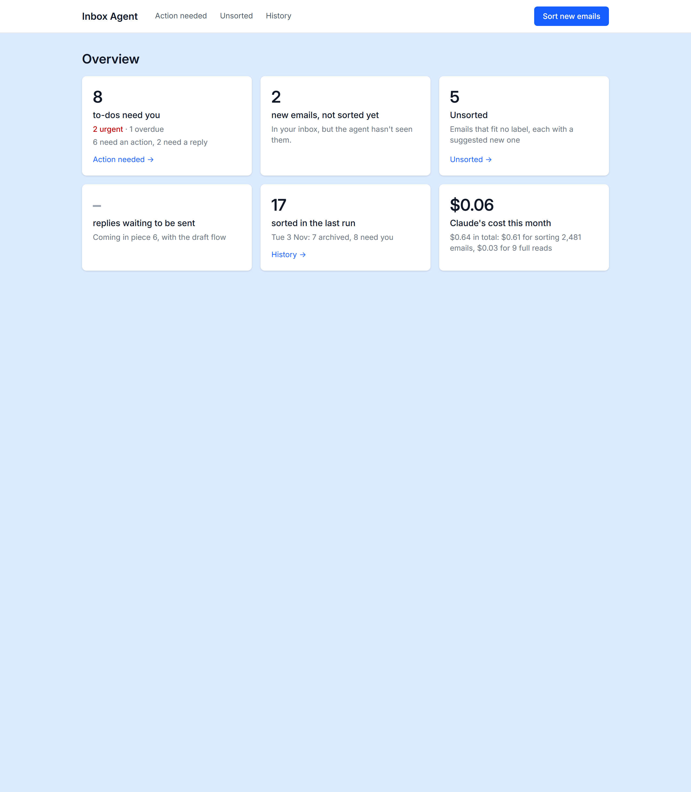
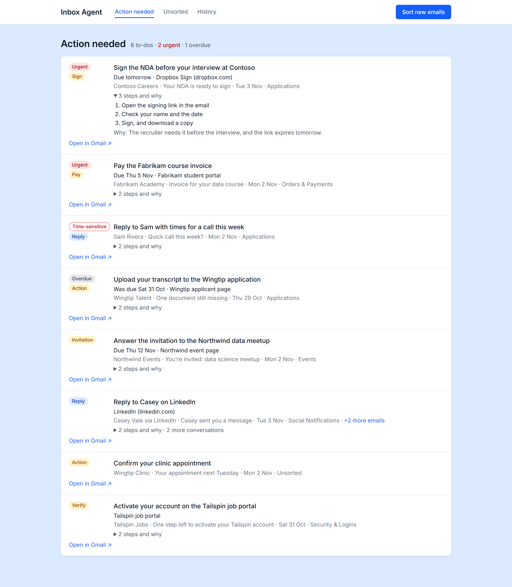
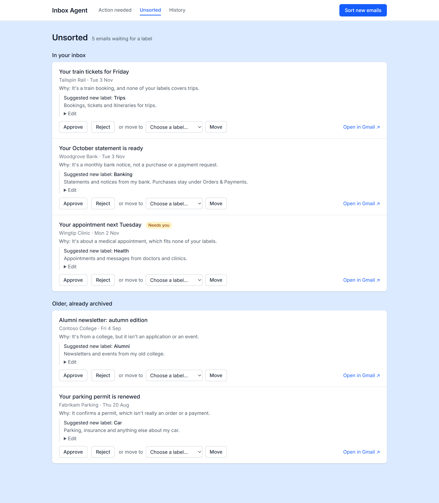
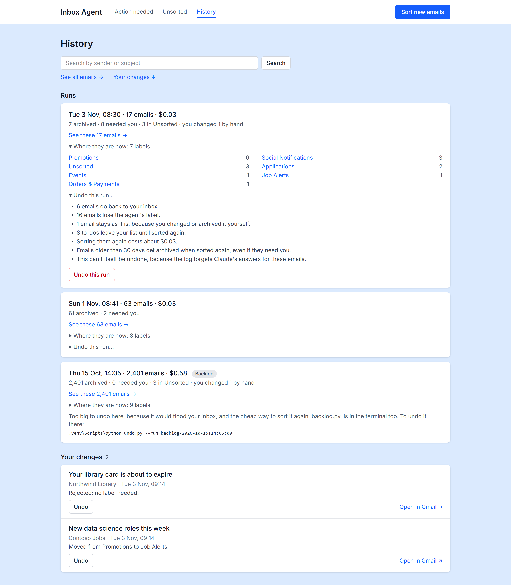
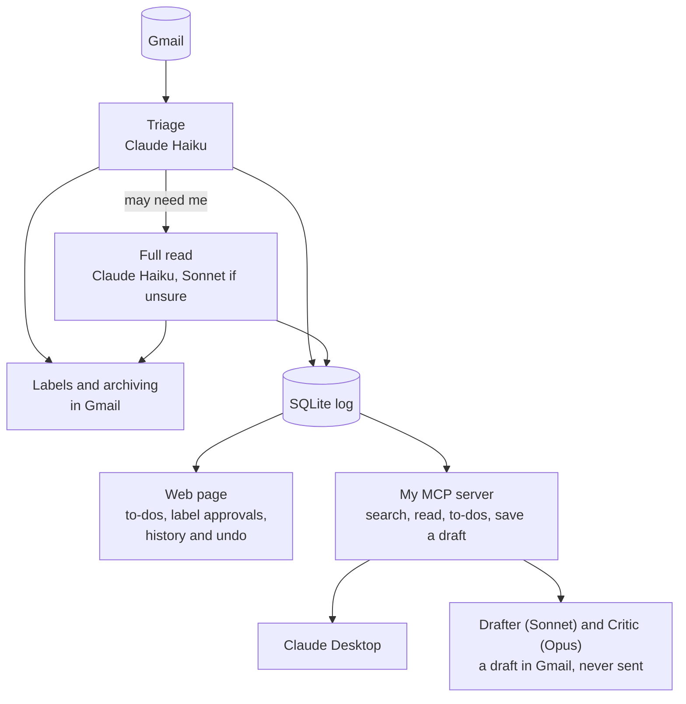

# Inbox Agent

An AI agent that organizes my Gmail. It sorts every email into labels, flags what needs a reply or an action from me, drafts replies in my writing style, and shows it all on a private web page. Several Claude models work together, each with its own job.

**It sorted my whole backlog: 6,547 emails for $1.54, taking my inbox from 6,494 emails to 60.** It has no way to send or delete an email, and I can undo what it does.

## What it looks like

These are the real pages, with made-up emails. Click a picture to see it full size.

<table>
  <tr>
    <th width="50%">Home: what needs me and what it has cost</th>
    <th width="50%">Action needed: my to-dos, most pressing first</th>
  </tr>
  <tr>
    <td></td>
    <td></td>
  </tr>
  <tr>
    <th>Unsorted: emails that fit no label, each with a suggestion</th>
    <th>History: what each run did, and how to undo it</th>
  </tr>
  <tr>
    <td></td>
    <td></td>
  </tr>
</table>

## How it works

1. **Triage** reads the sender, subject and preview of each new email and picks one of my labels. It archives the email unless it needs me. An email that fits no label stays in the inbox as "Unsorted", with a suggested new label for me to approve.
2. **The full read** goes through the whole of any email that may need me, and works out what to do, where and by when.
3. **The log** records every decision in SQLite, so no email gets sorted or paid for twice, and a run can be undone.
4. **The web page** runs only on my own computer. It shows my to-dos, most pressing first, and lets me approve labels, correct the agent and undo what it did.
5. **My own MCP server** gives AI apps safe tools for my Gmail. Claude Desktop uses it, and so does the **Drafter**, an agent that writes replies in my style. A **Critic** checks each draft before it can be saved to Gmail, and I review and send it myself.

| Job | Model | Why this one |
|---|---|---|
| Sorting every email | Claude Haiku 5.5 | It runs on everything, so it has to be cheap and fast: about $0.24 per 1,000 emails in bulk |
| Reading emails that may need me | Claude Haiku 5.5, then Sonnet 5.5 when unsure | A careful second pass only where it pays off |
| Designing labels and learning my writing style | Claude Opus 5.5 | These run rarely, so the best model is worth the cost |
| Drafting a reply | Claude Sonnet 5.5 | Capable and cheaper |
| Reviewing each draft | Claude Opus 5.5 | Checks every fact against what the Drafter saw |

## The decisions I'd point to

- **Nothing it does is irreversible.** The code has no function that sends or deletes an email. Google's narrowest permission for changing labels also allows sending, so the real boundary is my code.
- **I approve what changes the system.** The agent labels and archives by itself, because each is easy to undo. A new label needs my approval, because it changes how every future email gets sorted.
- **Emails are untrusted input.** Anyone can email me, so the prompts treat email text as content, never as instructions. Triage has no tools, so the worst a malicious email can do is get itself mislabeled.
- **The agent reads, the code writes.** The Drafter only has read-only tools. My code saves the draft, and only after the Critic approves, so the model can't skip the review.
- **My own MCP server instead of a ready-made one.** Community Gmail servers usually include send and delete. Mine only has the tools I chose.
- **Private by design.** The web page loads no outside scripts and refuses requests forged by other websites. Secrets and personal data stay out of Git.

## Status

- **In use on my real inbox:** sorting, labels, archiving and undo from the terminal, and the MCP tools in Claude Desktop.
- **Tried on real emails, without changing anything:** the full read, the Drafter and the Critic.
- **Built, with the first real clicks still to come:** the web page's buttons that change Gmail. So far they've run on copies of my real log with a stand-in for Gmail's API: more than 2,200 checks for the History page alone, using throwaway scripts that aren't in this repo.
- **Next:** drafting from the web page, accuracy tests for the models, and a demo with made-up emails.

**Built with:** Python, FastAPI, Jinja2, HTMX, Tailwind CSS, SQLite, the Gmail API, the Claude API (structured outputs and the Message Batches API) and the Model Context Protocol.

## Read more

- [How it works and why](docs/design-decisions.md): every design decision and the safety rules
- [Build log](docs/build-log.md): how I built it step by step, what I learned, the results and what's left
- [Setup](docs/setup.md): how to run it yourself
