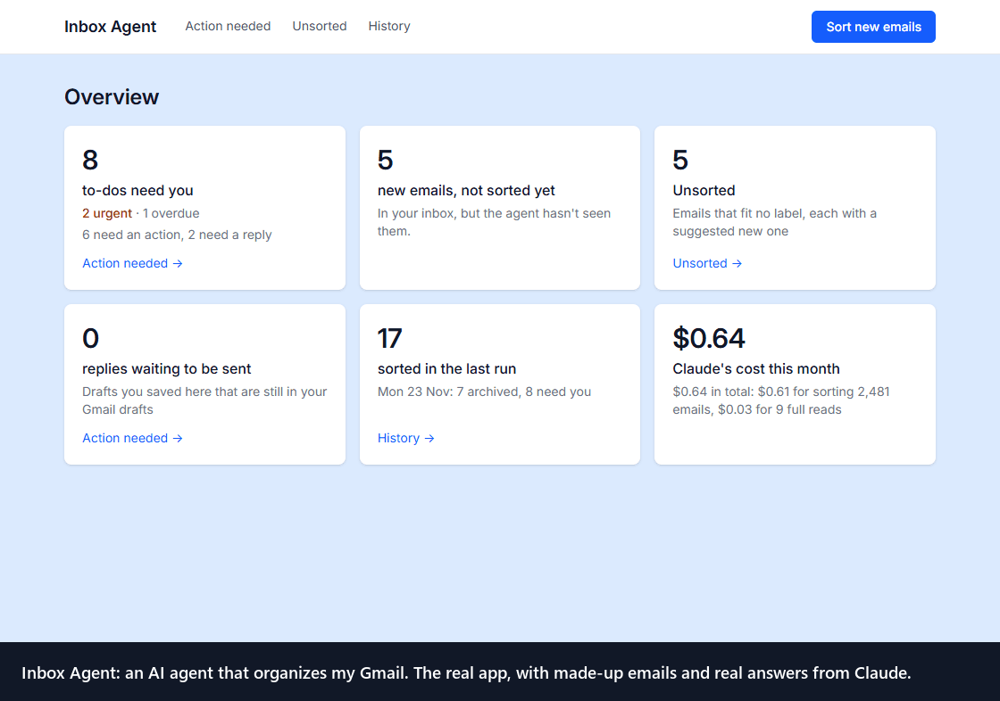
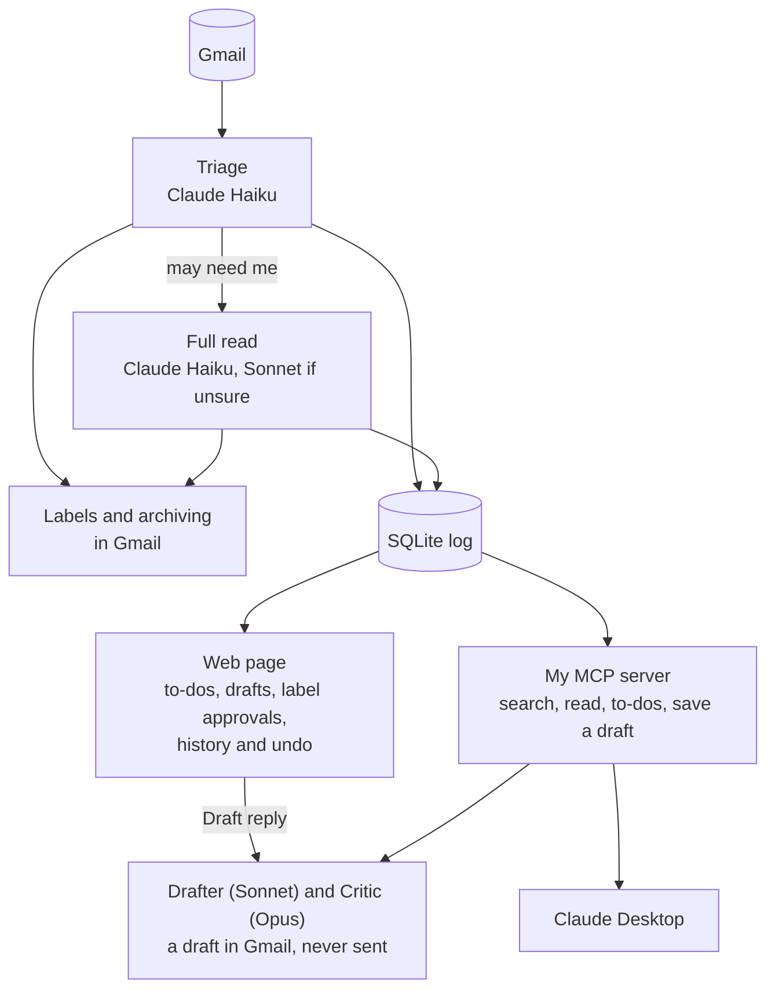

# Inbox Agent

An AI agent that organizes my Gmail. It sorts every new email into my labels, works out which ones need a reply or an action from me and by when, drafts replies in my writing style, and shows it all on a private web page. Several Claude models work together, each with its own job, and a Critic reviews every draft before I see it.

**It sorted my whole backlog: 6,547 emails for $1.54, taking my inbox from 6,494 emails to 60.** It has no way to send or delete an email, and I can undo what it does.



*The real app, with made-up emails and Claude's real answers to them. For this recording a stand-in took Gmail's place, so no real inbox was touched. 84 seconds, looping.*

## How it works



1. **Triage** reads the sender, subject and preview of each new email and picks one of my labels. It archives the email unless it needs me. An email that fits no label stays in the inbox as "Unsorted", with a suggested new label for me to approve.
2. **The full read** goes through the whole of any email that may need me, and works out what to do, where and by when.
3. **The log** records every decision in SQLite, so no email gets sorted or paid for twice, and a run can be undone.
4. **The web page** runs only on my own computer. It shows my to-dos, most pressing first, and lets me draft replies, approve labels, correct the agent and undo what it did.
5. **My own MCP server** gives AI apps safe tools for my Gmail. Claude Desktop uses it, and so does the **Drafter**, an agent that writes replies in my style. A **Critic** reviews each draft, and then I edit it if I want, save it to my Gmail drafts, and send it myself.

| Job | Model | Why this one |
|---|---|---|
| Sorting every email | Claude Haiku 5.5 | It runs on everything, so it has to be cheap and fast: about $0.24 per 1,000 emails in bulk |
| Reading emails that may need me | Claude Haiku 5.5, then Sonnet 5.5 when unsure | A careful second pass only where it pays off |
| Designing labels and learning my writing style | Claude Opus 5.5 | These run rarely, so the best model is worth the cost |
| Drafting a reply | Claude Sonnet 5.5 | Capable and cheaper |
| Reviewing each draft | Claude Opus 5.5 | Checks every fact against what the Drafter saw |

## The decisions I'd point to

- **Nothing it does is irreversible.** The code has no function that sends or deletes an email. Google's narrowest permission for changing labels also allows sending, so the real boundary is my code.
- **I approve what changes the system.** The agent labels and archives by itself, because each is easy to undo. A new label needs my approval, because it changes how every future email gets sorted.
- **Emails are untrusted input.** Anyone can email me, so the prompts treat email text as content, never as instructions. Triage has no tools, so the worst a malicious email can do is get itself mislabeled.
- **The agent reads, the code writes.** The Drafter only has read-only tools, so it can't save anything itself. My code saves the draft: from the terminal only once the Critic approves, and on the page only when I press Save, with the Critic's verdict right above the button. When the Critic found problems, the button says "Save anyway".
- **My own MCP server instead of a ready-made one.** Community Gmail servers usually include send and delete. Mine only has the tools I chose.
- **Private by design.** The web page loads no outside scripts and refuses requests forged by other websites. Secrets and personal data stay out of Git, and a check before every commit refuses my private details.

## Status

- **In use on my real inbox:** the web page and every button on it: sorting new emails with the full read, label approvals and changes, clearing to-dos, "Needs action" and undo, and drafting replies with the Drafter and the Critic, then editing them and saving them to my Gmail drafts. Also sorting from the terminal, and the MCP tools in Claude Desktop.
- **How it was tested:** each button first on copies of my real log, with stand-ins for Gmail's API and a fake connection to Claude (more than 2,200 checks for the History page alone, in throwaway scripts that aren't in this repo), then pressed once on my real inbox, with the log compared against a backup. The first real draft cost $0.06 and was approved on the Critic's first review.
- **Not measured yet:** how often Claude picks the right label or spots a to-do. I've checked samples by hand, and the log keeps every correction I make on the page, but there are no accuracy tests yet.
- **Limits:** it runs only on my own computer, for one Gmail account. While my Google app is in Testing, Google ends the login every 7 days, and signing in again is one click on the page. I've only run it on Windows: the Mac steps in the setup haven't been tried on a real Mac.
- **Next:** accuracy tests (evals) for sorting and the full read, built from my own corrections in the log. Then a double-click shortcut that starts the page, so opening it doesn't need a terminal. More ideas are in the build log's [What's left](docs/build-log.md#whats-left).

## Run it yourself

It runs on your own computer, with your own Claude API key and Google account. The short version is below, for Windows in PowerShell. [Setup](docs/setup.md) has every step, the Mac commands, and the extras, like the backlog sorter and Claude Desktop.

1. Install Python 3.13, then get the code and the packages, at the exact versions I use:
   ```
   git clone https://github.com/nabiltea/inbox-agent.git
   cd inbox-agent
   py -3.13 -m venv .venv
   .venv\Scripts\activate
   pip install -r requirements.txt -c constraints.txt
   ```
   You don't need `requirements-dev.txt`: it's only for remaking the demo GIF.
2. Copy `.env.example` to `.env`, and paste in an API key from the Claude Console.
3. In Google Cloud Console, turn on the Gmail API, set up the OAuth consent screen in Testing with yourself as a test user, and create a **Desktop app** OAuth client. Save its file as `credentials.json` in the project folder.
4. Run `python triage.py` for a dry run: it signs you in to Gmail, then shows which label Claude would give your 20 newest emails and which ones need you. Nothing in Gmail changes.
5. Make it yours. Your labels go in `labels.json`, in the format of `labels.example.json`, which the agent uses until you make one. `python label_designer.py` can suggest a set from your inbox for about $0.40. The Drafter reads your profile in `profile/`: an about-me file like `profile.example/about_me.md`, and a description of your writing style that `python style_builder.py` writes from your sent emails.
6. Build the page's styles with Tailwind's standalone program ([Setup](docs/setup.md), step 15), start the page with `python -m uvicorn web.app:app`, and open http://127.0.0.1:8000.
7. Start small: `python triage.py 10 --apply` sorts your 10 newest emails for real. Look at what changed in Gmail, and undo the run on the History page if you don't like it. After that, **Sort new emails** on the page sorts everything in your inbox the agent hasn't seen yet. For a big backlog, `backlog.py` costs half as much ([Setup](docs/setup.md), step 10).

Sorting costs about a tenth of a cent per email, full reads included, and a draft about 5 to 20 cents. Each press of Sort or Write draft stops at $0.50.

**Built with:** Python, FastAPI, Jinja2, HTMX, Tailwind CSS, SQLite, the Gmail API, the Claude API (structured outputs and the Message Batches API) and the Model Context Protocol. The demo GIF was made with Playwright and Pillow.

## Read more

- [How it works and why](docs/design-decisions.md): every design decision and the safety rules
- [Build log](docs/build-log.md): how I built it step by step, what I learned, the results and what's left
- [Setup](docs/setup.md): every step for running it yourself, and what each file does
