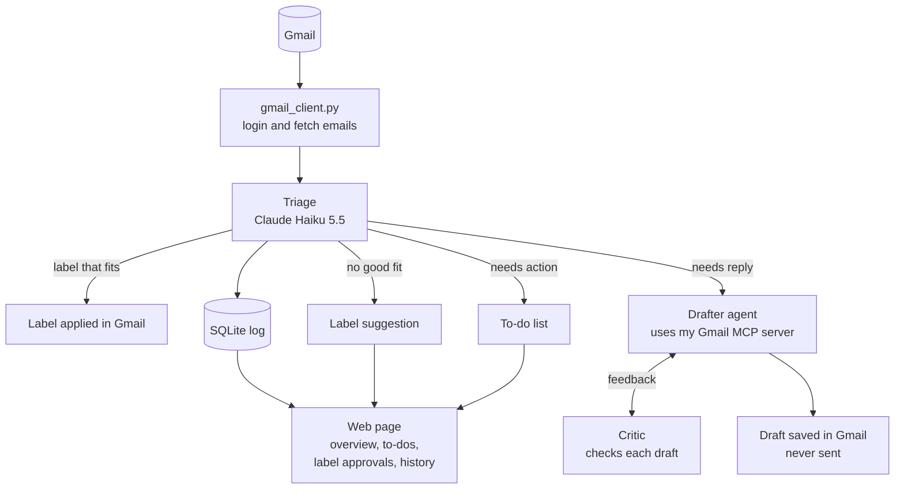

# How it works and why

How Inbox Agent is put together, and the decisions behind it. [Back to the README](../README.md).

## How it works



Built: `gmail_client.py`, Triage (including applying labels in Gmail), the Label Designer, the SQLite log, the backlog sorter, the Gmail MCP server, the Drafter and the Critic, and the web page's home, Action needed, Unsorted and History pages. Drafting from the web page isn't built yet, so drafts come from `drafter.py` for now.

### The Gmail MCP server's tools

| Tool | What it does | Can change Gmail? |
|---|---|---|
| `search_emails` | Searches all mail with Gmail's search syntax, and returns sender, subject, date, preview and labels | No |
| `read_thread` | Returns a whole conversation: each message's sender, recipients, date and text | No |
| `list_todos` | My to-do list: one entry per conversation the agent flagged as needing a reply or an action that's still in my inbox, the same list as the web page | No |
| `create_reply_draft` | Saves a reply inside a conversation as a draft. It is never sent. Reply by default, Reply all only when asked | Only adds a draft |

There is deliberately no tool to send, delete, archive or relabel anything.

### How the MCP server works

**Three layers.** `gmail_client.py` holds everything that talks to Gmail, and my own scripts use all of it, including the functions that change labels. `gmail_mcp_server.py` is the menu offered to AI apps: it picks the safe abilities, describes them for a model and leaves the rest out. The model itself (Claude) only reads and writes text. When it wants a tool, it asks the app it runs in, and the app makes the call. The model never talks to the server directly.

```
You ──▶ App (Claude Desktop) ──▶ Model (Claude): "call list_todos"
              │
              ▼
        gmail_mcp_server.py ──▶ Gmail + my database
              │
              ▼
        App ──▶ Model: "here's the result" ──▶ answer to me
```

**stdin, stdout and stderr.** The app starts the server in the background and connects to its three standard channels:

```
App                                   gmail_mcp_server.py
 │ ── stdin:  requests (JSON) ─────────▶ │
 │ ◀─ stdout: answers (JSON) ─────────── │
 │ ◀─ stderr: plain text for humans ──── │  → saved to a log, never read as JSON
```

stdin and stdout carry the conversation as JSON messages: the handshake, the list of tools, then each tool call and its answer. stderr is a side channel for warnings and errors, which the app stores in a log. That's why the code never prints to stdout: a stray message there would be read as JSON and break the connection.

| Part | Model | Job |
|---|---|---|
| Triage | Claude Haiku 5.5 | Sorts each email, flags needs reply / needs action. Cheap and fast, because it runs on every email |
| Label Designer | Claude Opus 5.5 | Reads a few hundred emails and my existing labels, and suggests labels with descriptions. Runs rarely, so the best model is worth the cost |
| Drafter | Claude Sonnet 5.5 (effort medium) | An agent: decides for itself whether to look up past emails with the MCP server's read-only tools, then writes a reply |
| Critic | Claude Opus 5.5 (effort high) | Checks each draft against everything the Drafter saw, for made-up facts, promises I never made, missed questions and wrong tone, and sends it back for changes |
| Action reader | Claude Haiku 5.5 | Reads the whole email when it may need action, and finds what to do, where and by when. Answers yes, no or unsure |
| Action reviewer | Claude Sonnet 5.5 | Looks only at the emails the Action reader was unsure about |

## Design decisions

### Who decides what

The agent acts on its own when an action is low-risk and easy to undo. It needs my approval when an action changes how the whole system behaves, and it never does anything that can't be undone.

| Action | Who decides | Why |
|---|---|---|
| Apply a label | Agent alone | Affects one email, easy to undo |
| Archive a sorted email | Agent alone | Easy to undo. Emails that need a reply or an action, and Unsorted ones, stay in the inbox |
| Flag "needs reply" or "needs action" | Agent alone | It's only information |
| Create a new label | Agent suggests, I approve | Changes how every future email is sorted |
| Draft a reply | Agent alone | It's only a draft |
| Send an email | Never the agent | Can't be undone |

**Why the agent doesn't create labels by itself:** it only sees one email at a time, but a good label covers a pattern across many emails. Letting it create labels freely would lead to near-duplicates ("Job Alerts", "Job Notifications"), each new label would change where future emails go, and anyone who emails me could influence my inbox's structure. Instead, emails that fit no label go to "Unsorted" with a suggested label. The web page lists them, each with its suggestion, and I approve, edit or reject each one, or pick a label by hand.

### Safety

- **No send or delete tools.** The agent can label, flag and draft, nothing more. Even if an email tricks the model, it can't send or delete anything.
- **Prompt injection defense.** Anyone can email me, so email content is untrusted. The email goes inside `<email>` tags, and the prompt says to treat everything inside them as content, never as instructions. Triage also has no tools, so the worst a malicious email can do is get itself mislabeled.
- **Least privilege, and being honest about its limits.** The app asks Google only for the permissions the current step needs. Steps 2 and 3 were read-only. Applying labels needs `gmail.modify`, the narrowest Google permission that can change labels on emails. It also covers drafts and sending, so the real safety boundary is the code: `gmail_client.py` has no function that sends or deletes anything.
- **Every change can be undone.** The agent only adds labels and archives, and it never deletes anything. Every change is logged, and `undo.py` or the History page reverses a run: it removes the labels the agent added and moves archived emails back into the inbox. Labels that were already on an email, for example from my own Gmail filters, are recorded as such and left alone by undo.
- **Archive only what doesn't need me.** Emails that need a reply or an action, and Unsorted ones, stay in the inbox. So a wrong label can never hide something I have to deal with.
- **Start small and check.** The first real run labeled only 10 emails. A separate check read the labels back from Gmail, rather than trusting the script's own output. Undo was tested the same way before relabeling.
- **Secrets stay out of Git.** The API key (`.env`), the Google app file (`credentials.json`) and my saved login (`token.json`) are all in `.gitignore`.
- **Less data sent to the model.** Triage sends only the sender, subject and preview, not the full email.
- **The MCP server is safe by construction.** Its tools can only read and save drafts. Each tool is marked with MCP annotations (`read_only_hint`, `destructive_hint`), so apps know which ones change something and can ask before using them. The server also tells every app that email content is untrusted, and to treat it as information, never as instructions.
- **Personal data stays out of Git.** The Label Designer's suggestions quote subjects from my real emails, and its label descriptions name companies I applied to, so `labels_proposed.json` is in `.gitignore`. The final label file, `labels.json`, is handled the same way, with a shareable example file in the repo instead.
- **Only my computer can open the web page.** Its server listens on 127.0.0.1 rather than on the network, so other devices on the same Wi-Fi can't reach it. That matters because the page has buttons that change my Gmail.
- **Email content can't run as code on the web page.** The templates escape every value they fill in, so a `<` in an email subject is shown as text. A test with a planted `<script>` tag confirmed it.
- **No outside scripts on the web page.** Every file the browser loads comes from my own app, because a script from somewhere else, running at my app's address, could read my pages and press my buttons. So Tailwind's styles get built into a local CSS file instead of loaded from a CDN, and FastAPI's automatic documentation pages, which load scripts from a CDN, are switched off. The font is served by the app too: loading it from Google Fonts would tell Google about every page I open.
- **The web app can't hand out other files.** It only serves files from `web/static/`. Requests that try to climb out of that folder, like `/static/../../token.json`, get "404 Not Found".

### Engineering choices

- **The right model for each job.** Haiku for high-volume sorting, stronger models only where judgment matters.
- **Structured outputs instead of parsing text.** Triage describes the answer it wants as a Pydantic class. The API forces Claude to answer in exactly that shape, and the label field only allows names from the label list, so Claude can't invent a label.
- **The agent reads, the code writes.** The Drafter only gets read-only tools (search and read emails). Saving the draft is done by my code, and only after the Critic approves. The model can't skip the review, because it has no way to save anything itself.
- **Limits are enforced in code, not only asked for in the prompt.** The Drafter's prompt says its lookups only cover emails with the people who wrote in the conversation, but the code also adds that limit to every search and refuses other conversations. A prompt can be ignored or tricked; code can't.
- **Learn the style once, reuse it every time.** Instead of the Drafter looking up how I write for every draft, a writing-style file is built once from my sent emails, and I can read and edit it. It's cheaper, more predictable, and under my control.
- **The reviewer sees the same evidence as the writer.** Everything the Drafter looked up goes to the Critic as well, so the Critic can check every fact in the draft against what the Drafter actually saw.
- **Placeholders instead of guesses.** When a reply needs something only I know (availability, a decision, a price), the Drafter writes a placeholder like `[your availability]` and lists it, instead of inventing an answer.
- **Give the model what it always needs.** The Drafter gets the conversation up front instead of spending a turn fetching it. It decides for itself whether anything else is worth looking up.
- **Workflow where possible, agent where needed.** In triage, my code decides every step and Claude makes one decision per email (a workflow). The Drafter is a real agent that decides for itself which tools to use.
- **Gmail code separate from AI code.** All Gmail code is in `gmail_client.py`. That keeps the AI code simple, and it's what became my Gmail MCP server.
- **My own MCP server instead of a ready-made one.** Community Gmail MCP servers usually include send and delete, and would mean trusting someone else's code with my inbox. My own server only has the tools I choose, and it also works in Claude Desktop.
- **Gmail filters and the agent work together.** My filters already sort job alerts by sender address. The agent catches the ones the filters miss by recognizing what an email is, not just who sent it.
- **Facts come from code, judgment comes from the model.** Anything the code can check for itself (like whether a label already exists in Gmail) is computed in code, not asked of the model. The model is only used for decisions that need judgment. The other way around applies too: the model finds a deadline, but whether that makes an email *urgent* is a rule in my code.
- **A cheap first pass for everything, a careful second pass where it pays off.** Triage reads only the preview of every email. Only emails that may need action get a full read.
- **A model cascade.** A cheap model (Haiku) does the full read, and a stronger one (Sonnet) only reviews the cases the first one is unsure about. "Unsure" is defined concretely in the prompt, because a model's own sense of uncertainty isn't fully reliable.
- **Missing a to-do is worse than a false alarm.** The action check leans towards flagging, and there's a manual "Needs action" button as a safety net.
- **Label descriptions are the prompt.** The model only knows what a label means from its description, so fixing wrong labels usually means rewriting descriptions.
- **A log of every decision.** A SQLite database (`inbox_agent.db`) records what the agent decided about each email and whether it added the label. So no email is processed (or paid for) twice, any run can be undone, and the log feeds the web page and will feed the accuracy tests.
- **Dry run by default.** `triage.py` only changes Gmail when you add `--apply`. Running it without that is always safe.
- **To-dos only for recent emails.** Emails older than 30 days are archived even if flagged as needing a reply or an action, because they've been dealt with. The flags are still logged, as test data for the model.
- **stdout belongs to MCP.** An MCP server talks to its app over stdin/stdout, so any stray `print()` would break the connection. All messages in `gmail_client.py` go to stderr instead. The server also never opens a browser to sign in, because nobody would see it. If the Gmail login has expired, the tool says so, and I sign in from the web page.
- **One Gmail request at a time in the server.** Apps can call several tools at once, each on its own thread, but Google's client library isn't safe to use from two threads at once. A lock makes the tools take turns. (Replaced in Step 7, piece 1e, part 5: every tool call now makes its own connection, so nothing is shared.)
- **Bulk where it pays.** Fetching emails uses Gmail batch requests (50 at a time). The 6,500-email backlog used Claude's Message Batches API (half price, results within hours), while the daily run stays one email at a time, since that's only a few emails.
- **Gmail labels aren't folders.** An email is stored once, whatever its labels. "Inbox" is just another label, and archiving removes it. So labeling and archiving don't change storage. The point of archiving is a clear inbox, not saving space.
- **Database migrations.** When the log gained an `archived` column, `database.py` adds it to existing database files automatically, instead of requiring the old log to be deleted.
